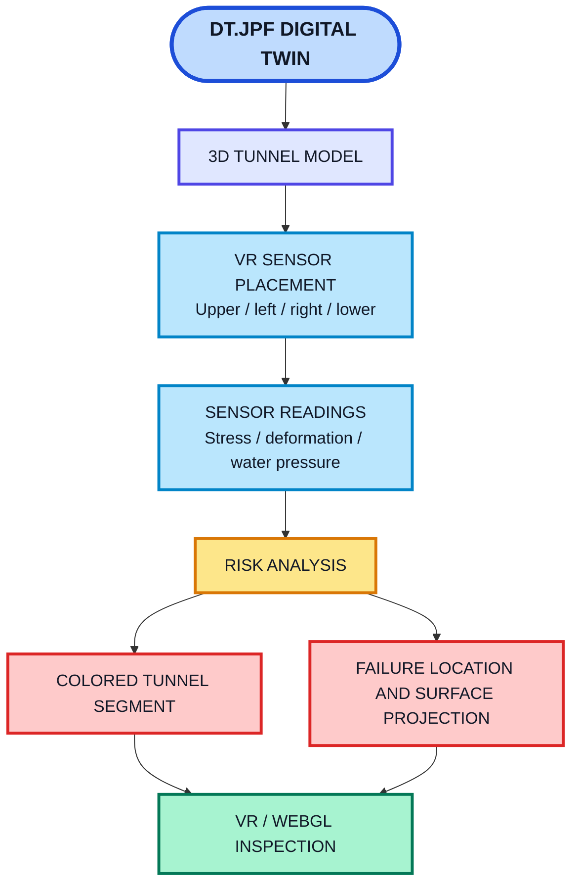
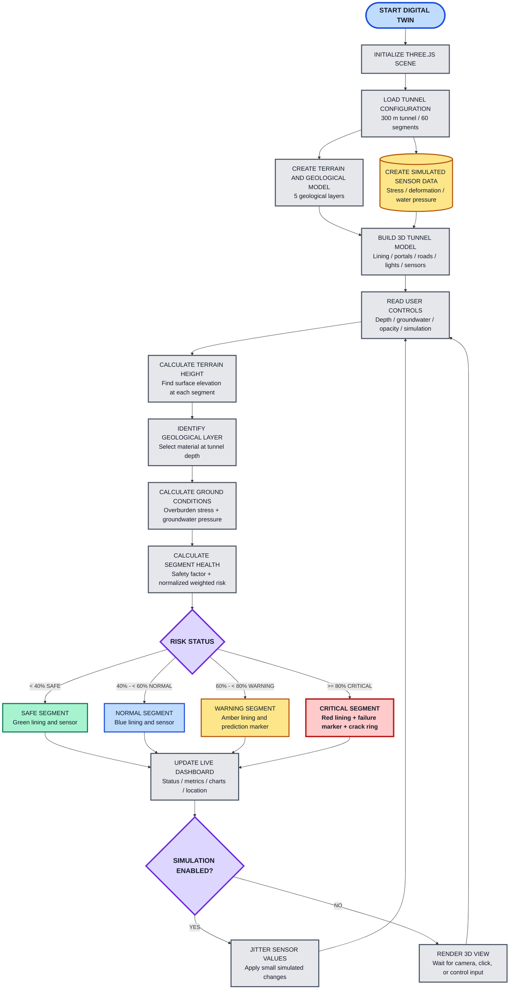
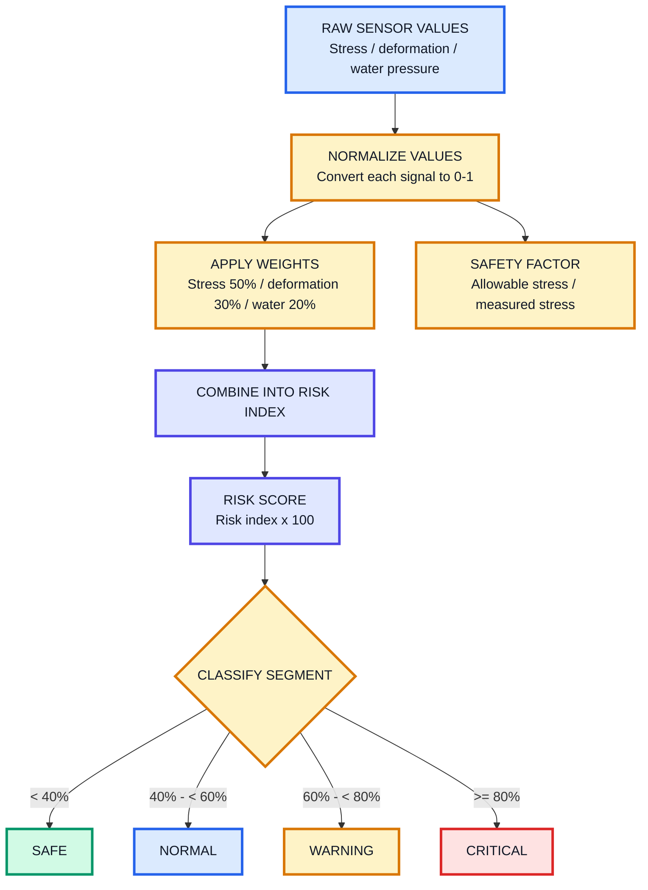
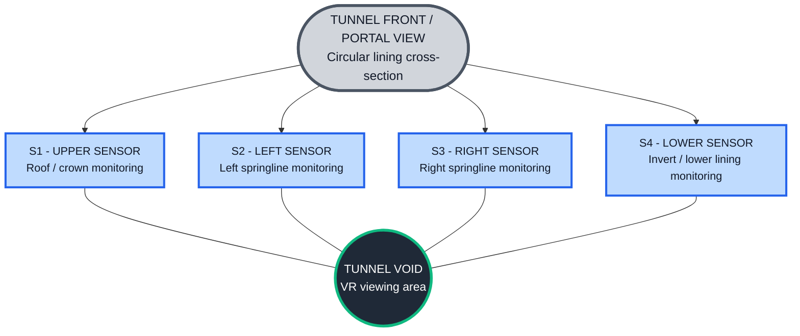
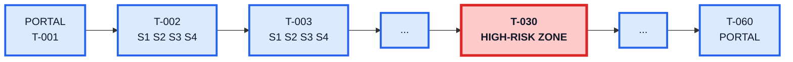
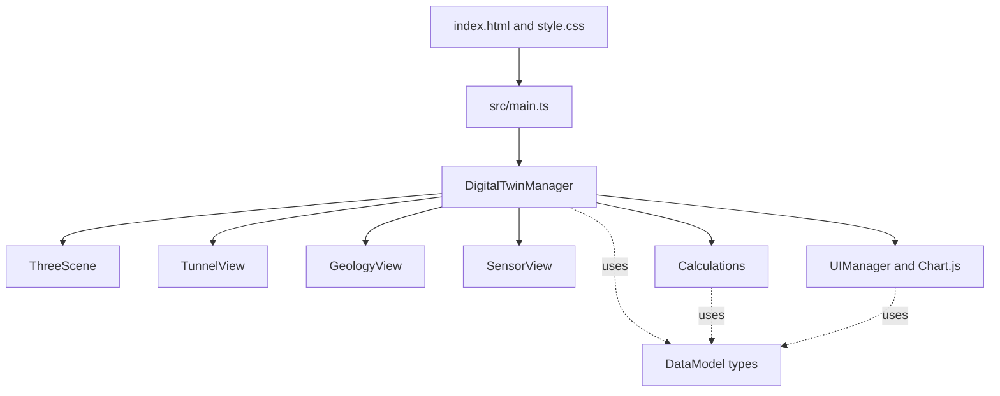

## Digital-twin VR sensing overview

This project presents a browser-based 3D tunnel digital twin for inspecting tunnel geometry, geological layers, sensor locations, and predicted failure zones. The digital twin mirrors the tunnel as a virtual model and connects each tunnel segment with simulated sensing data.

<p align="center">
  
</p>

<p align="center"><em>VR sensing and digital-twin inspection concept</em></p>

### VR sensor placement

Each tunnel segment contains four virtual sensors positioned around the inner lining:

- **Upper sensor:** monitors the tunnel roof or crown.
- **Left sensor:** monitors the left sidewall.
- **Right sensor:** monitors the right sidewall.
- **Lower sensor:** monitors the invert or lower lining.

The sensors report:

- **Stress** in kPa
- **Deformation** in mm
- **Water pressure** in kPa

The digital twin uses these readings to calculate segment risk, change the tunnel color, show the highest-risk location, and project a predicted failure point to the surface. A future WebXR mode can use the same sensor positions for VR inspection, controller selection, teleport points, and live sensor overlays.



> **Current capability:** the project currently provides a Three.js WebGL digital twin with orbit-camera inspection. WebXR headset tracking and VR controllers are planned integration points; the sensor layout and data flow are already documented for that future mode.

An interactive browser-based digital twin prototype for a tunnel, its surrounding geological layers, and tunnel-segment health. The application combines a Three.js 3D model with simulated sensor readings and a live risk-analysis dashboard.

> **Prototype notice:** sensor values are generated in the browser and the critical area around `T-030` is intentionally artificial. This project is for visualization and workflow demonstration; it is not a structural-safety or geotechnical design tool.

## What the digital twin does

The application creates a 300 m tunnel divided into 60 segments (`T-001` to `T-060`). For every segment it:

1. Creates a 3D tunnel lining, interior, floor, support rib, lights, and four sensor markers.
2. Places the tunnel inside a procedural terrain surface and five geological layers.
3. Generates baseline stress, deformation, and water-pressure readings.
4. Calculates overburden stress and groundwater pressure from the selected tunnel depth and water table.
5. Combines sensor values into a weighted risk score.
6. Colors the corresponding tunnel segment by its current status.
7. Displays the highest-risk segment, predicted failure location, surface projection, charts, and selected-segment details.
8. Optionally jitters the simulated sensors over time when **Run Simulation** is enabled.

## System workflow



## How risk is calculated

Every tunnel segment is evaluated as a small health record. The twin combines **three sensor signals**, normalizes them to a common 0-1 range, and produces one risk score.

| Sensor signal | Unit | What it indicates |
|---|---:|---|
| **Stress** | kPa | Load acting on the tunnel lining |
| **Deformation** | mm | Movement or convergence of the tunnel |
| **Water pressure** | kPa | Groundwater pressure around the tunnel |

### Calculation flow



### Weighted risk formula

```text
Risk index =
    (0.50 x normalized stress)
  + (0.30 x normalized deformation)
  + (0.20 x normalized water pressure)

Risk score   = Risk index x 100
Safety factor = Allowable geological stress / Measured stress
```

<table>
  <tr>
    <td align="center"><strong>50%</strong><br/>Stress weight</td>
    <td align="center"><strong>30%</strong><br/>Deformation weight</td>
    <td align="center"><strong>20%</strong><br/>Water-pressure weight</td>
    <td align="center"><strong>0-100%</strong><br/>Risk-score range</td>
  </tr>
</table>

> **How to read it:** higher stress, deformation, or water pressure increases the risk score. A lower safety factor means the measured stress is closer to the geological layer's allowable stress.

The default status thresholds are:

| Risk score | Status | Meaning |
|---:|---|---|
| `< 40%` | `SAFE` | Low calculated risk |
| `40% - < 60%` | `NORMAL` | Monitor the segment |
| `60% - < 80%` | `WARNING` | Elevated risk; inspect the segment |
| `>= 80%` | `CRITICAL` | Failure prediction is shown |

The dashboard uses the highest-risk segment as the tunnel-wide status. A failure marker and dashed surface-projection line are shown when the maximum risk is at least `60%`; a wireframe crack ring is added at `80%` or above.

## Visual shapes and their meaning

The following diagram shows the visual vocabulary used by the 3D twin. The Mermaid shapes are chosen to resemble the corresponding object or its role in the scene.

```mermaid
flowchart TB
    A(["SEGMENTED CYLINDER<br/>Tunnel lining / one segment"])
    B[("DARK INNER CYLINDER<br/>Interior shotcrete or rock")]
    C(["DARK RING<br/>Support rib at a joint"])
    D["RECTANGULAR PLANE / BOX<br/>Roadway, portal, retaining wall, or geology"]
    E[["SMALL SENSOR BOXES<br/>Four sensor locations per segment"]]
    F(["TERRAIN MESH<br/>Procedural ground and approach roads"])
    G[["TRANSLUCENT GEOLOGY VOLUMES<br/>Geological layers"])
    H(("RED SPHERE<br/>Predicted failure at tunnel roof"))
    I -.-> J(("RED DASHED LINE<br/>Failure-to-surface projection"))
    K{{"RED WIREFRAME TORUS<br/>Severe-risk crack visualization"}}
    L[/"GRID + AXES<br/>Engineering reference frame"/]

    classDef tunnel fill:#d1d5db,stroke:#4b5563,color:#111827,stroke-width:3px;
    classDef interior fill:#4b4038,stroke:#1f2937,color:#ffffff,stroke-width:3px;
    classDef structure fill:#9ca3af,stroke:#374151,color:#111827,stroke-width:3px;
    classDef sensor fill:#bfdbfe,stroke:#2563eb,color:#111827,stroke-width:3px;
    classDef terrain fill:#bbf7d0,stroke:#15803d,color:#111827,stroke-width:3px;
    classDef geology fill:#fde68a,stroke:#b45309,color:#111827,stroke-width:3px;
    classDef failure fill:#fecaca,stroke:#dc2626,color:#111827,stroke-width:3px;
    classDef reference fill:#e5e7eb,stroke:#6b7280,color:#111827,stroke-width:3px;

    class A tunnel;
    class B interior;
    class C,D structure;
    class E sensor;
    class F terrain;
    class G geology;
    class H,I,J,K failure;
    class L reference;
```

| Shape or visual element | Meaning in the 3D twin |
|---|---|
| Segmented cylinder | Tunnel lining; each cylinder is one tunnel segment |
| Dark inner cylinder | Interior shotcrete/rock surface |
| Dark ring | Steel or timber support rib at a segment joint |
| Rectangular plane/box | Roadway floor, portal wall, retaining wall, or geological volume |
| Small boxes around lining | Four simulated sensor locations per segment |
| Terrain mesh | Procedural ground surface with portal approach roads |
| Translucent rectangular volumes | Geological layers |
| Red sphere | Predicted failure location at the tunnel roof |
| Red dashed line | Vertical projection from the predicted failure to the surface |
| Red wireframe torus | Severe-risk crack visualization |
| Grid and axes | Engineering reference frame |

## Digital-twin sensor placement: front and underside views

Each tunnel segment contains four small sensor boxes mounted around the inside of the lining. The diagrams below show the intended placement when viewing the digital twin from the tunnel entrance and from underneath the tunnel.

### Front view: tunnel entrance

The front view looks along the tunnel axis. The sensor markers are distributed around the circular lining so the roof, side, and lower lining behavior can be monitored together.



### Underside view: sensor line along the tunnel

The underside view looks upward from below the tunnel floor and follows the tunnel length. Each `T-###` segment repeats the same four-sensor arrangement. A VR user can move along this line and inspect the readings for the selected segment.



### Sensor behavior in the digital twin

- Four sensor markers are created for every tunnel segment.
- The current implementation places them on the inside of the lining using four angular positions around the cross-section.
- Sensor readings are **stress**, **deformation**, and **water pressure**.
- Segment colors change from green, blue, amber, or red based on the calculated risk.
- Clicking a segment opens its sensor values in the selected-segment panel.
- The highest-risk segment receives a red failure marker and a vertical surface-projection line when the risk threshold is reached.

> **VR note:** The current project provides a Three.js WebGL 3D twin with orbit-camera controls. It does not yet enable WebXR headset tracking or VR controllers. The front and underside diagrams describe the sensor layout that a future VR mode can use for teleport points, controller selection, and inspection.

## Color system

### Segment and dashboard status colors

These colors are used consistently in the 3D tunnel, sensor markers, status badge, and charts.

<table>
  <thead>
    <tr>
      <th>Swatch</th>
      <th>Status</th>
      <th>Hex</th>
      <th>Used for</th>
    </tr>
  </thead>
  <tbody>
    <tr>
      <td><span style="display:inline-block;width:56px;height:22px;background:#10b981;border:1px solid #047857;border-radius:4px;"></span></td>
      <td><strong>SAFE</strong></td>
      <td><code>#10b981</code></td>
      <td>Safe segments and healthy sensors</td>
    </tr>
    <tr>
      <td><span style="display:inline-block;width:56px;height:22px;background:#3b82f6;border:1px solid #1d4ed8;border-radius:4px;"></span></td>
      <td><strong>NORMAL</strong></td>
      <td><code>#3b82f6</code></td>
      <td>Normal segments and stress chart</td>
    </tr>
    <tr>
      <td><span style="display:inline-block;width:56px;height:22px;background:#f59e0b;border:1px solid #b45309;border-radius:4px;"></span></td>
      <td><strong>WARNING</strong></td>
      <td><code>#f59e0b</code></td>
      <td>Warning segments and deformation chart</td>
    </tr>
    <tr>
      <td><span style="display:inline-block;width:56px;height:22px;background:#ef4444;border:1px solid #b91c1c;border-radius:4px;"></span></td>
      <td><strong>CRITICAL</strong></td>
      <td><code>#ef4444</code></td>
      <td>Critical segments, failure status, and risk chart</td>
    </tr>
    <tr>
      <td><span style="display:inline-block;width:56px;height:22px;background:#ea580c;border:1px solid #9a3412;border-radius:4px;"></span></td>
      <td><strong>HIGH</strong></td>
      <td><code>#ea580c</code></td>
      <td>High-severity interface accent</td>
    </tr>
  </tbody>
</table>

### Geological layer colors

The transparent geology volumes use the following material palette:

<table>
  <thead>
    <tr>
      <th>Swatch</th>
      <th>Layer</th>
      <th>Hex</th>
      <th>Approximate material</th>
    </tr>
  </thead>
  <tbody>
    <tr>
      <td><span style="display:inline-block;width:56px;height:22px;background:#8B4513;border:1px solid #451f0a;border-radius:4px;"></span></td>
      <td><strong>Topsoil</strong></td>
      <td><code>#8B4513</code></td>
      <td>Brown soil</td>
    </tr>
    <tr>
      <td><span style="display:inline-block;width:56px;height:22px;background:#DAA520;border:1px solid #8a6a14;border-radius:4px;"></span></td>
      <td><strong>Loose Sand</strong></td>
      <td><code>#DAA520</code></td>
      <td>Golden sand</td>
    </tr>
    <tr>
      <td><span style="display:inline-block;width:56px;height:22px;background:#D2691E;border:1px solid #873f12;border-radius:4px;"></span></td>
      <td><strong>Stiff Clay</strong></td>
      <td><code>#D2691E</code></td>
      <td>Orange-brown clay</td>
    </tr>
    <tr>
      <td><span style="display:inline-block;width:56px;height:22px;background:#808080;border:1px solid #4b5563;border-radius:4px;"></span></td>
      <td><strong>Weathered Rock</strong></td>
      <td><code>#808080</code></td>
      <td>Gray rock</td>
    </tr>
    <tr>
      <td><span style="display:inline-block;width:56px;height:22px;background:#404040;border:1px solid #111827;border-radius:4px;"></span></td>
      <td><strong>Hard Rock</strong></td>
      <td><code>#404040</code></td>
      <td>Dark rock</td>
    </tr>
  </tbody>
</table>

### Environment and lighting accents

| Swatch | Element | Visual meaning |
|---|---|---|
| <span style="display:inline-block;width:56px;height:22px;background:#2a2a2a;border:1px solid #111827;border-radius:4px;"></span> | Approach asphalt | Dark gray road outside the tunnel |
| <span style="display:inline-block;width:56px;height:22px;background:#4a7a2e;border:1px solid #36591f;border-radius:4px;"></span> | Terrain and vegetation | Green/olive mountain slopes and valleys |
| <span style="display:inline-block;width:56px;height:22px;background:#ff9933;border:1px solid #b45309;border-radius:4px;"></span> | Tunnel lights | Warm industrial lighting |
| <span style="display:inline-block;width:56px;height:22px;background:#ff0000;border:1px solid #991b1b;border-radius:4px;"></span> | Failure marker | Predicted failure location and projection |

## User workflow

The complete operator flow is shown below. The workflow starts with the 3D twin, moves through inspection and scenario testing, and returns to the live dashboard after every analysis update.

```mermaid
flowchart TB
    A(["1. START DEVELOPMENT SERVER<br/>npm run dev"]) --> B["2. OPEN DIGITAL TWIN<br/>Inspect isometric tunnel and live analysis panel"]
    B --> C["3. CHOOSE CAMERA VIEW<br/>ISOMETRIC / TOP / PORTAL / SIDE / INSIDE"]
    C --> D["4. LOCATE HIGHEST-RISK AREA<br/>Use LOCATE FAILURE to focus the camera"]
    D --> E["5. SELECT A TUNNEL SEGMENT<br/>Click a segment to inspect sensor values"]
    E --> F["6. OPEN DIGITAL TWIN CONTROLS<br/>Adjust depth, geology, groundwater, or simulation"]
    F --> G{"RUN A SCENARIO?"}
    G -->|"NO"| H["7. REVIEW CURRENT STATE<br/>Compare dashboard, charts, and segment colors"]
    G -->|"YES"| I["CHANGE PARAMETERS<br/>Depth / groundwater / opacity / stress / water / deformation"]
    I --> J["RECALCULATE DIGITAL TWIN<br/>Rebuild geometry or update segment analysis"]
    J --> K{"RUN SIMULATION?"}
    K -->|"YES"| L["APPLY SMALL SENSOR CHANGES<br/>Observe changing risk values"]
    L --> J
    K -->|"NO"| H
    H --> M{"TEST ANOTHER SCENARIO?"}
    M -->|"YES"| F
    M -->|"NO"| N(["8. FINISH INSPECTION<br/>Use Reset Values to restore the baseline"])

    A:::start
    B:::inspect
    C:::camera
    D:::failure
    E:::sensor
    F:::controls
    G:::decision
    H:::dashboard
    I:::controls
    J:::analysis
    K:::decision
    L:::simulation
    M:::decision
    N:::finish

    classDef start fill:#bfdbfe,stroke:#1d4ed8,color:#111827,stroke-width:4px,font-size:18px,font-weight:bold;
    classDef inspect fill:#e0e7ff,stroke:#4f46e5,color:#111827,stroke-width:3px,font-size:17px;
    classDef camera fill:#ddd6fe,stroke:#7c3aed,color:#111827,stroke-width:3px,font-size:17px;
    classDef failure fill:#fecaca,stroke:#dc2626,color:#111827,stroke-width:3px,font-size:17px;
    classDef sensor fill:#bae6fd,stroke:#0284c7,color:#111827,stroke-width:3px,font-size:17px;
    classDef controls fill:#fde68a,stroke:#d97706,color:#111827,stroke-width:3px,font-size:17px;
    classDef decision fill:#f3e8ff,stroke:#9333ea,color:#111827,stroke-width:4px,font-size:18px,font-weight:bold;
    classDef dashboard fill:#bbf7d0,stroke:#059669,color:#111827,stroke-width:3px,font-size:17px;
    classDef analysis fill:#fed7aa,stroke:#ea580c,color:#111827,stroke-width:3px,font-size:17px;
    classDef simulation fill:#fecdd3,stroke:#e11d48,color:#111827,stroke-width:3px,font-size:17px;
    classDef finish fill:#a7f3d0,stroke:#047857,color:#111827,stroke-width:4px,font-size:18px,font-weight:bold;
```



### Workflow explanation

1. **Start the development server:** Run `npm run dev` and open the local Vite URL in a WebGL-enabled browser.
2. **Inspect the initial state:** Confirm that the 3D tunnel, geological terrain, sensor markers, live status, metrics, and charts are visible.
3. **Change the camera view:** Use the wired camera controls to inspect the tunnel from different engineering viewpoints.
4. **Locate the failure area:** `LOCATE FAILURE` moves the camera to the segment with the highest calculated risk.
5. **Inspect a segment:** Clicking a tunnel segment opens its stress, deformation, and water-pressure readings.
6. **Run a scenario:** Use the controls to change depth, groundwater, geology visibility, opacity, or sensor multipliers. Depth changes rebuild the 3D model; other changes update the analysis.
7. **Review the result:** Compare the dashboard status, three charts, segment colors, safety factor, and predicted failure projection.
8. **Repeat or reset:** Test another scenario, or select **Reset Values** to return to baseline sensor data and multipliers.

### Control reference

| Control | Result |
|---|---|
| `ISOMETRIC`, `TOP`, `PORTAL`, `SIDE`, `INSIDE` | Switch the 3D camera viewpoint |
| **LOCATE FAILURE** | Focus the camera on the highest-risk segment |
| **Tunnel Depth** | Rebuild the tunnel and recalculate the analysis |
| **Groundwater Lvl** | Recalculate groundwater pressure and risk |
| **Show Geology** | Show or hide the geological cutaway |
| **Layer Opacity** | Change geological-layer transparency |
| **Stress +10%**, **Water +10%**, **Deformation +10%** | Test a higher sensor scenario |
| **Run Simulation** | Apply small random sensor changes over time |
| **Reset Values** | Restore baseline multipliers and regenerated sensor data |

The three charts should be compared with the 3D segment colors and dashboard status after each scenario.

The `SECTION` button is present in the HTML controls but does not currently have a camera handler in `DigitalTwinManager`.

## Application architecture



Important source files:

- [`src/DigitalTwinManager.ts`](./src/DigitalTwinManager.ts) - application orchestration, controls, sensor simulation, analysis loop, and camera actions.
- [`src/DataModel.ts`](./src/DataModel.ts) - tunnel, geology, sensor, and analysis types.
- [`src/Calculations.ts`](./src/Calculations.ts) - terrain, layer, overburden, water-pressure, and risk calculations.
- [`src/TunnelView.ts`](./src/TunnelView.ts) - tunnel geometry, portals, lights, segment colors, and sensor boxes.
- [`src/GeologyView.ts`](./src/GeologyView.ts) - terrain and translucent geological cutaway layers.
- [`src/SensorView.ts`](./src/SensorView.ts) - failure marker, projection line, and crack visualization.
- [`src/UIManager.ts`](./src/UIManager.ts) - dashboard values, status badge, and Chart.js charts.
- [`src/ThreeScene.ts`](./src/ThreeScene.ts) - renderer, camera, orbit controls, lighting, grid, and axes.

## Run locally

### Requirements

- Node.js 18 or newer
- npm
- A browser with WebGL support

### Install and start

```bash
npm install
npm run dev
```

Open the local URL printed by Vite, usually `http://localhost:5173`.

### Production build

```bash
npm run build
npm run preview
```

`npm run build` runs the TypeScript compiler and then creates the Vite production bundle.

## Current limitations and next steps

- Sensor data is generated locally instead of arriving from real instruments or an IoT gateway.
- The critical zone is seeded for demonstration and is not inferred from field measurements.
- The model uses simplified geotechnical formulas and fixed geological parameters.
- No data persistence, authentication, alert delivery, historical replay, or server-side API is included.
- For a production twin, connect validated sensors, add timestamps and data quality checks, calibrate the soil/rock model, persist time series, and require engineering review before using any alert operationally.
