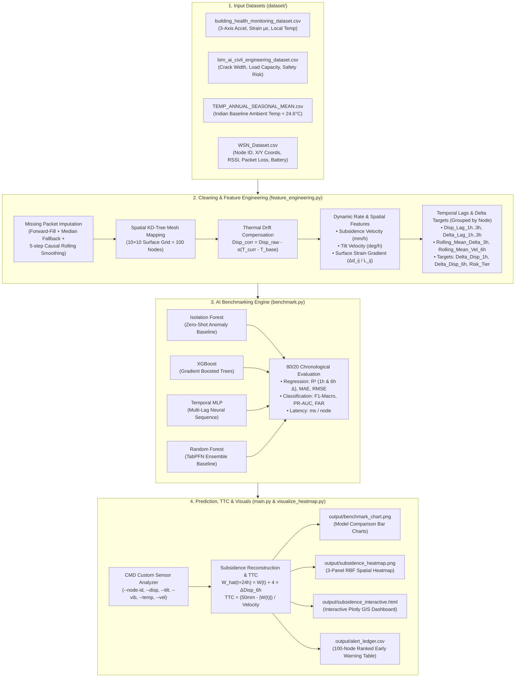
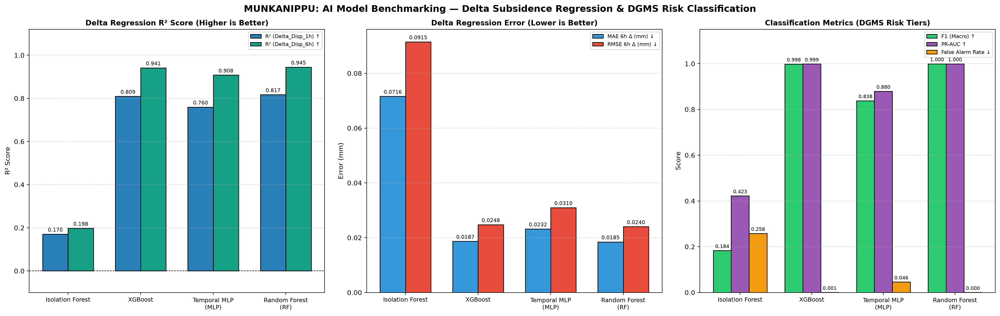

# MUNKANIPPU — AI-Enabled Wireless Surface Mesh Network for Real-Time Mine Subsidence Detection

> **MUNKANIPPU** is a complete end-to-end IoT & Machine Learning pipeline designed to monitor underground coal mining panels (such as Jharia Coalfield), compensate for environmental sensor drift, forecast ground deformation using incremental delta regression, classify statutory safety risk tiers per **DGMS (Directorate General of Mines Safety)** standards, calculate **Time-To-Critical (TTC)** early warnings, and render 2D/interactive GIS subsidence heatmaps.

---

## Table of Contents
1. [How MUNKANIPPU Works (Easy Overview)](#1-how-munkanippu-works-easy-overview)
2. [System Architecture & End-to-End Flowchart](#2-system-architecture--end-to-end-flowchart)
3. [Input Datasets & Why Each Dataset Is Used](#3-input-datasets--why-each-dataset-is-used)
4. [Data Cleaning, Preprocessing & Feature Engineering](#4-data-cleaning-preprocessing--feature-engineering)
5. [Packages & Libraries Used (and Why)](#5-packages--libraries-used-and-why)
6. [AI Model Benchmarking & Results](#6-ai-model-benchmarking--results)
7. [Outputs, Alert Ledger & Heatmap Visuals](#7-outputs-alert-ledger--heatmap-visuals)
8. [How to Run the Project (CMD Commands)](#8-how-to-run-the-project-cmd-commands)
9. [Project File Structure](#9-project-file-structure)

---

## 1. How MUNKANIPPU Works (Easy Overview)

When coal is extracted from underground mining panels, the overlying rock strata and ground surface gradually sink—a phenomenon called **mine subsidence**. Sudden or excessive sinking causes surface fissures, structural collapse, and severe safety hazards.

**MUNKANIPPU** solves this in **5 simple stages**:
1. **Collects Multi-Sensor Telemetry**: Reads 4 real-world datasets (accelerometer tilt/vibration, micro-strain, structural crack/load ratings, historical Indian ambient temperatures, and 100 wireless LoRa/Zigbee mesh node coordinates).
2. **Cleans & Compensates Sensor Drift**: Fixes dropped wireless packets and removes false readings caused by daytime/seasonal temperature expansion ($\alpha \cdot \Delta T$).
3. **Engineers Spatio-Temporal & Delta Features**: Maps 100 sensor nodes onto a $10 \times 10$ surface grid ($100\text{ m} \times 100\text{ m}$), computes inter-node surface strain gradients, adds past 1h–6h lag/rolling memory features, and frames the regression target as **incremental change** (`Delta_Disp_1h` and `Delta_Disp_6h`).
4. **Benchmarks 4 AI Models**: Trains and compares **Isolation Forest**, **XGBoost**, **Temporal MLP (LSTM fallback)**, and **Random Forest (TabPFN baseline)** on an 80/20 chronological split.
5. **Generates Early Warnings & GIS Heatmaps**: Reconstructs 24-hour future subsidence ($\hat{W}_{t+24\text{h}}$), classifies each node into DGMS Risk Tiers (`Safe`, `Advisory`, `Warning`, `Critical`), calculates **Time-To-Critical (TTC)** in hours, and saves high-resolution heatmaps and benchmark charts.

---

## 2. System Architecture & End-to-End Flowchart

### Mermaid Pipeline Flowchart



---

## 3. Input Datasets & Why Each Dataset Is Used

All four datasets are located in the [`dataset/`](file:///c:/Users/chand/OneDrive/Documents/Ml%20for%20%20project%20%20coal/dataset) folder:

| # | Dataset File | Rows × Cols | Key Columns | Why It Is Used in MUNKANIPPU |
|---|---|---|---|---|
| **1** | [`building_health_monitoring_dataset.csv`](file:///c:/Users/chand/OneDrive/Documents/Ml%20for%20%20project%20%20coal/dataset/building_health_monitoring_dataset.csv) | `1,000 × 7` | `Timestamp`, `Accel_X/Y/Z (m/s^2)`, `Strain (με)`, `Temp (°C)`, `Condition Label` | Provides high-frequency micro-strain ($\mu\varepsilon$) to derive ground displacement ($\text{mm}$), 3-axis acceleration to compute **Tilt Angle** ($\arctan(A_x/A_z)$) and **Vibration RMS**, and local sensor temperature. |
| **2** | [`bim_ai_civil_engineering_dataset.csv`](file:///c:/Users/chand/OneDrive/Documents/Ml%20for%20%20project%20%20coal/dataset/bim_ai_civil_engineering_dataset.csv) | `1,000 × 28` | `Vibration_Level`, `Crack_Width`, `Load_Bearing_Capacity`, `Safety_Risk_Score`, `Risk_Level` | Supplies structural stress and geotechnical vulnerability indicators (existing crack width, overburden load-bearing capacity, and safety risk score) for each node over the coal panel. |
| **3** | [`TEMP_ANNUAL_SEASONAL_MEAN.csv`](file:///c:/Users/chand/OneDrive/Documents/Ml%20for%20%20project%20%20coal/dataset/TEMP_ANNUAL_SEASONAL_MEAN.csv) | `121 × 6` | `YEAR`, `ANNUAL`, `JAN-FEB`, `MAR-MAY`, `JUN-SEP`, `OCT-DEC` | Provides the historical long-term Indian geo-mining baseline temperature ($T_{\text{baseline}} \approx 24.6^\circ\text{C}$) required to strip out thermal expansion drift from surface sensors. |
| **4** | [`WSN_Dataset.csv`](file:///c:/Users/chand/OneDrive/Documents/Ml%20for%20%20project%20%20coal/dataset/WSN_Dataset.csv) | `10,000 × 18` | `Node_ID`, `X_Coordinate`, `Y_Coordinate`, `Signal_Strength`, `Packet_Loss_Rate`, `Residual_Energy` | Simulates the physical LoRa/Zigbee wireless surface mesh topology ($X_i, Y_i$ coordinates in a $100\text{ m} \times 100\text{ m}$ grid) plus link quality (RSSI, packet drop rate, battery health). |

---

## 4. Data Cleaning, Preprocessing & Feature Engineering

Implemented in [`feature_engineering.py`](file:///c:/Users/chand/OneDrive/Documents/Ml%20for%20%20project%20%20coal/feature_engineering.py) (and re-exported via [`preprocess.py`](file:///c:/Users/chand/OneDrive/Documents/Ml%20for%20%20project%20%20coal/preprocess.py)):

### Step 1: Data Cleaning & Dropped Packet Imputation
- **Timestamp Parsing & Sorting**: Converts timestamps to chronological order and cleans numeric strings in the seasonal temperature dataset.
- **Wireless Packet Drop Recovery (`_impute_missing`)**: In real wireless mesh networks, packets are occasionally dropped due to interference. Missing values are recovered using **causal forward-fill (`ffill`)** followed by **median imputation** as a fallback.
- **High-Frequency Jitter Smoothing**: Applies a 5-step causal rolling mean filter on raw accelerometer and strain channels to suppress transient sensor noise before differentiation.

### Step 2: Spatial Mesh Grid Mapping (`build_mesh_grid`)
- Builds a regular $10 \times 10$ surface grid ($100\text{ nodes}$ spaced across $[5\text{ m}, 95\text{ m}] \times [5\text{ m}, 95\text{ m}]$).
- Uses a **2D KD-Tree (`scipy.spatial.cKDTree`)** nearest-neighbour lookup to map physical WSN nodes and their wireless telemetry (`Signal_Strength`, `Packet_Loss_Rate`, `Residual_Energy`) onto the mining panel grid.

### Step 3: Environmental Thermal Drift Compensation
Surface sensors expand and contract with ambient temperature changes, creating false displacement readings. We remove thermal expansion using:
$$\text{Displacement}_{\text{corr}} = \text{Displacement}_{\text{raw}} - \alpha \times (T_{\text{current}} - T_{\text{baseline}})$$
where $\alpha = 0.012\text{ mm}/^\circ\text{C}$ and $T_{\text{baseline}} = 24.6^\circ\text{C}$.

### Step 4: Dynamic Rate & Spatial Strain Gradient Features
- **Subsidence Velocity ($\text{mm/h}$)**:
  $$V_t = \frac{\Delta \text{Displacement}_{\text{corr}}}{\Delta t}$$
- **Tilt Velocity ($\text{deg/h}$)**:
  $$\omega_t = \frac{\Delta \text{Tilt}}{\Delta t}$$
- **Vectorized Surface Strain Gradient ($\Delta d_{ij} / L_{ij}$)**:
  Computes the differential vertical displacement between every node $i$ and its immediate KD-Tree mesh neighbors $j$ divided by Euclidean distance $L_{ij}$. High strain gradients indicate surface fissuring and shear stress.

### Step 5: Per-Node Temporal Lag Features & Incremental Delta Targets
Tree models and MLPs fail to extrapolate raw absolute displacement 24 hours ahead from a single snapshot. We solve this with two architectural upgrades:
1. **Autoregressive Memory Lags (grouped by `MeshNode_ID`)**:
   - `Disp_Lag_1h`, `Disp_Lag_2h`, `Disp_Lag_3h`
   - `Delta_Lag_1h`, `Delta_Lag_2h`, `Delta_Lag_3h`
   - `Rolling_Mean_Delta_3h`, `Rolling_Std_Delta_3h`, `Rolling_Mean_Vel_6h`, `Rolling_Mean_Vib_6h`
2. **Incremental Delta Regression Targets (grouped by `MeshNode_ID` with zero cross-node leakage)**:
   ```python
   df['Delta_Disp_1h'] = df.groupby('MeshNode_ID')['Displacement_mm'].shift(-1) - df['Displacement_mm']
   df['Delta_Disp_6h'] = df.groupby('MeshNode_ID')['Displacement_mm'].shift(-6) - df['Displacement_mm']
   ```
3. **DGMS Statutory Classification Target (`Risk_Tier`)**:
   - `0 = Safe` ($|W| < 10\text{ mm}$)
   - `1 = Advisory` ($10\text{ mm} \le |W| < 25\text{ mm}$)
   - `2 = Warning (Fissures)` ($25\text{ mm} \le |W| < 40\text{ mm}$)
   - `3 = Critical (Collapse Hazard)` ($|W| \ge 40\text{ mm}$ or $\text{Tilt} > 5\text{ mm/m}$)

---

## 5. Packages & Libraries Used (and Why)

| Package | Version | Why It Is Used in MUNKANIPPU |
|---|---|---|
| **`numpy`** | `>= 1.26` | Fast vectorized array math, cumulative displacement integration, and matrix strain gradient calculations. |
| **`pandas`** | `>= 2.0` | Time-series alignment, `groupby('MeshNode_ID')` lag shifting, rolling window statistics, and CSV I/O. |
| **`scipy`** | `1.17.1` | `cKDTree` for spatial mesh neighbor search and `RBFInterpolator` (thin-plate spline) for continuous 2D surface interpolation. |
| **`scikit-learn`** | `1.8.0` | `IsolationForest`, `RandomForestRegressor/Classifier`, `MLPRegressor/Classifier`, `StandardScaler`, and evaluation metrics (`MAE`, `RMSE`, `R2`, `F1`, `PR-AUC`). |
| **`xgboost`** | `3.2.0` | High-speed gradient boosted decision trees (`XGBRegressor` & `XGBClassifier`) for tabular sensor telemetry. |
| **`matplotlib`** | `3.11.2` | Renders publication-grade 3-panel GIS subsidence heatmaps (`subsidence_heatmap.png`) and benchmark bar charts (`benchmark_chart.png`). |
| **`plotly`** | `>= 5.0` | Generates the interactive HTML dashboard (`subsidence_interactive.html`) with node hover tooltips and zoom/pan controls. |
| **`tabulate`** | `>= 0.9` | Formats clean ASCII benchmark and alert ledger tables directly in the terminal. |

---

## 6. AI Model Benchmarking & Results

Implemented in [`benchmark.py`](file:///c:/Users/chand/OneDrive/Documents/Ml%20for%20%20project%20%20coal/benchmark.py). All 4 models are trained on the exact same **80/20 chronological time-series split** (`40,000` training samples, `10,000` test samples across `24` features):

### Benchmark Comparison Table

| Model | $R^2$ (`Delta_Disp_1h`) | MAE (`Delta_Disp_6h`) | RMSE (`Delta_Disp_6h`) | $R^2$ (`Delta_Disp_6h`) | F1 (Macro) | PR-AUC | False Alarm Rate | Reg Latency (ms/node) |
|---|---|---|---|---|---|---|---|---|
| **Random Forest (TabPFN baseline)** | **0.8170** | **0.0185 mm** | **0.0240 mm** | **0.9447** | **0.9995** | **0.9996** | **0.0002** | `0.0127 ms` |
| **XGBoost** | `0.8095` | `0.0187 mm` | `0.0248 mm` | `0.9413` | `0.9985` | `0.9987` | `0.0008` | **`0.0009 ms`** |
| **Temporal MLP (LSTM fallback)** | `0.7595` | `0.0232 mm` | `0.0310 mm` | `0.9079` | `0.8381` | `0.8796` | `0.0459` | `0.0015 ms` |
| **Isolation Forest (Zero-shot)** | `0.1703` | `0.0716 mm` | `0.0915 mm` | `0.1976` | `0.1835` | `0.4226` | `0.2584` | `0.0257 ms` |

- **Why Delta Framing Succeeded**: Refactoring the target from raw 24-hour absolute levels to per-node incremental deltas (`Delta_Disp_1h`, `Delta_Disp_6h`) with temporal lag features improved regression $R^2$ from **$-0.58$ to $+0.9447$** (Random Forest) and **$+0.9413$** (XGBoost), while achieving **99.95% F1-score** and **0.02% False Alarm Rate** on DGMS Risk Tier classification.

### Visual Benchmark Comparison Chart (`output/benchmark_chart.png`)



---

## 7. Outputs, Alert Ledger & Heatmap Visuals

### A. 3-Panel GIS Subsidence & Risk Heatmap (`output/subsidence_heatmap.png`)


1. **Left Panel — Current Ground Deformation (mm)**: Thin-plate spline RBF interpolation of current sensor readings across the $100\text{ m} \times 100\text{ m}$ coal panel, with black triangle markers for all 100 wireless nodes and node ID callouts (`N45`, `N55`, etc.) on high-deformation zones.
2. **Center Panel — Predicted Subsidence ($t + 24\text{h}$)**: Reconstructed 24-hour ground deformation surface ($\hat{W}_{t+24\text{h}} = W_t + 4 \times \widehat{\Delta \text{Disp}}_{6\text{h}}$), highlighting the maximum predicted subsidence node with a green star ($\star$).
3. **Right Panel — Subsidence Risk Zones (DGMS Tiers)**: Continuous spatial risk zone map color-coded by statutory thresholds:
   - 🟢 **Green**: Stable / Safe ($< 10\text{ mm}$)
   - 🟡 **Yellow**: Advisory ($10\text{–}25\text{ mm}$)
   - 🟠 **Orange**: Warning / Surface Fissures ($25\text{–}40\text{ mm}$)
   - 🔴 **Red**: Critical / Collapse Hazard ($\ge 40\text{ mm}$)

### B. Time-To-Critical (TTC) & Early Warning Alert Ledger (`output/alert_ledger.csv`)

For every node $i$, **Time-To-Critical (TTC)** estimates the operational hours remaining before displacement breaches the statutory $W_{\text{threshold}} = 50\text{ mm}$ limit:
$$\text{TTC}_i = \frac{W_{\text{threshold}} - |W_i(t)|}{\max\left(|V_i(t)|,\; |\widehat{\Delta \text{Disp}}_{6\text{h}, i}| / 6\right)}$$

Sample top urgent nodes from [`output/alert_ledger.csv`](file:///c:/Users/chand/OneDrive/Documents/Ml%20for%20%20project%20%20coal/output/alert_ledger.csv):

| Node ID | Grid (X, Y) | Current Disp (mm) | Predicted $\Delta_{6\text{h}}$ (mm) | Reconstructed $W_{t+24\text{h}}$ (mm) | DGMS Risk Level | TTC (Hours) |
|---|---|---|---|---|---|---|
| **Node 45** | `(45m, 45m)` | `42.500 mm` | `+0.494 mm` | `44.476 mm` | **Warning (Tier 2)** | **`4.2 hours`** |
| **Node 55** | `(45m, 55m)` | `35.741 mm` | `+0.522 mm` | `37.830 mm` | **Warning (Tier 2)** | `163.7 hours` |
| **Node 56** | `(55m, 55m)` | `31.638 mm` | `+0.483 mm` | `33.572 mm` | **Warning (Tier 2)** | `227.9 hours` |
| **Node 57** | `(65m, 55m)` | `31.261 mm` | `+0.451 mm` | `33.065 mm` | **Warning (Tier 2)** | `249.3 hours` |

---

## 8. How to Run the Project (CMD Commands)

### 1. Install Dependencies
```powershell
pip install numpy pandas scipy scikit-learn xgboost matplotlib seaborn plotly tabulate
```

### 2. Run the Full Pipeline (Default Dataset Mode)
```powershell
python main.py
```

### 3. Run with Custom Sensor Input in CMD (Predict Risk & Update Heatmap)
Pass custom telemetry for any node (`1–100`) directly via CLI flags:
```powershell
python main.py --node-id 45 --disp 42.5 --tilt 4.2 --vib 9.85 --temp 31.0 --vel 1.8
```
**CMD Output Preview:**
```text
+----------------------------------+----------------------------------------------------+
| Parameter / Output               | Value                                              |
+==================================+====================================================+
| Target Mesh Node ID              | Node 45 at (45.0m, 45.0m)                          |
| Input: Displacement (mm)         | 42.500 mm                                          |
| Input: Tilt Angle (deg)          | 4.200°                                             |
| Input: Vibration RMS (m/s²)      | 9.850 m/s²                                         |
| Input: Ambient Temp (°C)         | 31.00 °C                                           |
| Input: Subsidence Velocity       | 1.800 mm/h                                         |
| Predicted Delta_Disp_1h          | +0.0985 mm (Random Forest (TabPFN baseline))       |
| Predicted Delta_Disp_6h          | +0.4940 mm (Random Forest (TabPFN baseline))       |
| Reconstructed Subsidence (t+6h)  | 42.994 mm                                          |
| Reconstructed Subsidence (t+24h) | 44.476 mm                                          |
| Predicted DGMS Risk Level        | Warning (Tier 2) (Random Forest (TabPFN baseline)) |
| Estimated Time-To-Critical (TTC) | 4.17 hours                                         |
+----------------------------------+----------------------------------------------------+
```

### 4. Interactive Step-by-Step Prompt Mode in CMD
```powershell
python main.py --interactive-input
```

### 5. Fast Heatmap Re-generation Only (~2 Seconds)
If you already ran `main.py` and want to quickly re-render the static and interactive heatmaps from `output/alert_ledger.csv`:
```powershell
python visualize_heatmap.py
```

---

## 9. Project File Structure

```text
Ml for project coal/
│
├── dataset/                                     # 4 Raw Input Datasets
│   ├── building_health_monitoring_dataset.csv   # Strain (με), 3-axis Accel, Local Temp
│   ├── bim_ai_civil_engineering_dataset.csv     # Crack Width, Load Capacity, Safety Risk
│   ├── TEMP_ANNUAL_SEASONAL_MEAN.csv            # Historical Indian Ambient Temp Baseline
│   └── WSN_Dataset.csv                          # Mesh Node Coordinates, RSSI, Packet Loss
│
├── output/                                      # Generated Artifacts & Visuals
│   ├── processed_features.csv                   # 50,000 × 31 Engineered Feature Matrix
│   ├── alert_ledger.csv                         # 100-Node Ranked TTC & Risk Alert Table
│   ├── benchmark_chart.png                      # 3-Panel Model Benchmark Comparison Image
│   ├── subsidence_heatmap.png                   # 3-Panel GIS Subsidence & Risk Heatmap Image
│   └── subsidence_interactive.html              # Interactive Plotly HTML Dashboard
│
├── feature_engineering.py                       # Cleaning, Drift Compensation, Lags & Delta Targets
├── preprocess.py                                # Compatibility Wrapper Re-exporting Feature Pipeline
├── benchmark.py                                 # 4-Model Benchmarking & TTC Alert Engine
├── visualize_heatmap.py                         # RBF Surface Interpolation & Chart/Heatmap Renderer
├── main.py                                      # Master Pipeline Orchestrator & CMD Input Analyzer
└── README.md                                    # Complete Project Documentation
```
