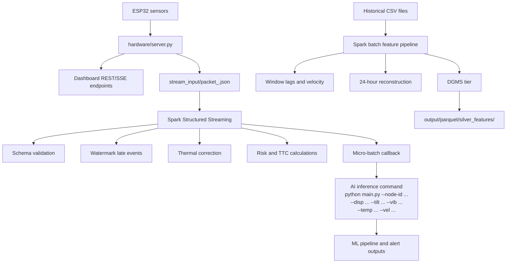

# MUNKANIPPU Spark Architecture

This document explains how Apache Spark is used in the MUNKANIPPU coal-mine
subsidence monitoring project.

## 1. Purpose

The Pandas pipeline is useful for local model development and small datasets.
The Spark layer provides a scale-out architecture for larger deployments with
thousands of sensor nodes and continuous telemetry.

Spark is used for two related workloads:

1. **Distributed batch feature engineering** in
   [`spark_feature_pipeline.py`](./spark_feature_pipeline.py).
2. **Real-time Structured Streaming** in
   [`spark_streaming_pipeline.py`](./spark_streaming_pipeline.py).

Both workloads produce the same operational concepts:

- corrected displacement
- sensor and temporal features
- DGMS risk tier
- time-to-critical (TTC)
- an input for downstream AI inference

## 2. End-to-end architecture



The hardware bridge and Spark jobs are deliberately separate. The bridge
collects and exposes telemetry, while Spark performs scalable transformation
and early-warning calculations.

## 3. Batch architecture

The batch job reads a CSV file into a Spark DataFrame. It then:

1. Infers the input schema.
2. Selects compatible node, timestamp, temperature, and displacement columns.
3. Applies thermal drift compensation.
4. Creates a per-node ordered window.
5. Calculates displacement lags, velocity, and delta targets.
6. Reconstructs projected 24-hour subsidence.
7. Assigns a DGMS risk tier.
8. Calculates TTC.
9. Writes a partitioned Parquet Silver table.

The per-node window is conceptually:

```text
Window.partitionBy(node_id).orderBy(timestamp)
```

This keeps a node's historical measurements together when calculating
lag-based features.

## 4. Streaming architecture

The streaming job monitors a directory containing newline-delimited JSON
telemetry files. The hardware bridge writes files such as:

```text
stream_input/packet_1.json
stream_input/packet_2.json
```

Spark reads new files incrementally with `readStream`. Each event is checked
against the explicit telemetry schema, then enriched with:

- `tilt_angle`
- `disp_corr`
- `velocity`
- `DGMS_Risk_Tier`
- `TTC_hours`

The default processing trigger is 20 seconds. At the end of each trigger,
`foreachBatch` calls `process_micro_batch`, which logs the node status and
prints the standardized command for `main.py`.

## 5. Why Spark is useful here

### Horizontal scaling

Spark partitions data and can process many nodes in parallel. The local
configuration uses all available local cores for batch processing, while a
production deployment can use a Spark cluster.

### Window functions

Sensor features depend on earlier readings from the same node. Spark SQL
window functions calculate these lags without manually iterating through every
node in Python.

### Fault tolerance

Structured Streaming uses a checkpoint directory to record progress. If the
streaming process restarts, Spark can recover its file-source progress instead
of treating every file as new.

### Late-event handling

Wireless packets can arrive out of order. The streaming job applies a
10-second watermark:

```python
stream_df.withWatermark("timestamp", "10 seconds")
```

This allows bounded lateness while preventing unbounded state growth.

### Columnar output

Parquet stores typed, compressed columns efficiently. The batch job partitions
the Silver output by `DGMS_Risk_Tier`, which makes risk-focused queries more
efficient.

## 6. Processing formulas

### Thermal drift correction

The Spark jobs use:

```text
Disp_corr = Disp_raw - alpha * (temperature - 24.6)
```

The batch pipeline defaults to `alpha = 0.05`. The streaming pipeline uses the
same model for its displacement proxy, based on force and temperature:

```text
Disp_corr = (force_level_pct * 0.5) - (temperature - 24.6) * 0.05
```

### Delta displacement

For a node ordered by timestamp:

```text
Delta_Disp_1h = Disp_corr(t) - Disp_corr(t-1)
Delta_Disp_6h = Disp_corr(t) - Disp_corr(t-6)
```

If a six-hour history is unavailable, the batch implementation estimates the
six-hour delta from the one-hour velocity.

### 24-hour reconstruction

The batch pipeline projects four six-hour increments:

```text
Pred_Subsidence_24h = Disp_corr + 4 * Delta_Disp_6h
```

### DGMS risk tiers

The current thresholds are:

| Projected absolute displacement | Tier |
|---:|---|
| `< 10 mm` | SAFE |
| `10 to < 25 mm` | ADVISORY |
| `25 to < 50 mm` | WARNING |
| `>= 50 mm` | CRITICAL |

These are project decision-support thresholds. Operational decisions must be
reviewed by the mine's qualified safety personnel.

### Time-to-critical

When the estimated positive subsidence velocity is above `0.05 mm/h`:

```text
TTC = (50 - abs(Disp_corr)) / Subsidence_Vel_mm_h
```

Otherwise the pipeline uses `999.0` as its stable/no-action sentinel.

## 7. Data layers and outputs

The project follows a lightweight medallion-style layout:

| Layer | Project representation | Purpose |
|---|---|---|
| Bronze | `stream_input/` JSON files | Raw live telemetry packets |
| Silver | `output/parquet/silver_features/` | Corrected and feature-engineered data |
| Gold/application | `output/alert_ledger.csv` and dashboard APIs | Ranked alerts and user-facing results |

Batch output is partitioned as:

```text
output/parquet/silver_features/
    DGMS_Risk_Tier=SAFE/
    DGMS_Risk_Tier=ADVISORY/
    DGMS_Risk_Tier=WARNING/
    DGMS_Risk_Tier=CRITICAL/
```

The streaming checkpoint is stored under:

```text
output/spark_checkpoints/
```

Do not delete a checkpoint directory while the corresponding stream is
expected to resume from its previous position.

## 8. Local mode and production mode

The checked-in code runs locally by default:

- batch: `local[*]`
- streaming: `local[2]`

This makes demonstrations and development possible on a workstation. For a
cluster deployment, the Spark session configuration should be supplied by the
cluster scheduler rather than forcing a local master. The transformation logic
can remain the same.

## 9. Relationship to the rest of the project

- [`hardware/server.py`](../../hardware/server.py) reads ESP32 serial data and
  writes stream packets.
- [`spark_streaming_pipeline.py`](./spark_streaming_pipeline.py) evaluates
  live packets and triggers downstream ML analysis.
- [`spark_feature_pipeline.py`](./spark_feature_pipeline.py) prepares
  historical features for large-scale batch processing.
- [`main.py`](./main.py) runs the model benchmark and alert-ledger workflow.
- [`kalman_filter.py`](./kalman_filter.py) provides an optional recursive
  filter for noisy telemetry before or alongside feature engineering.
