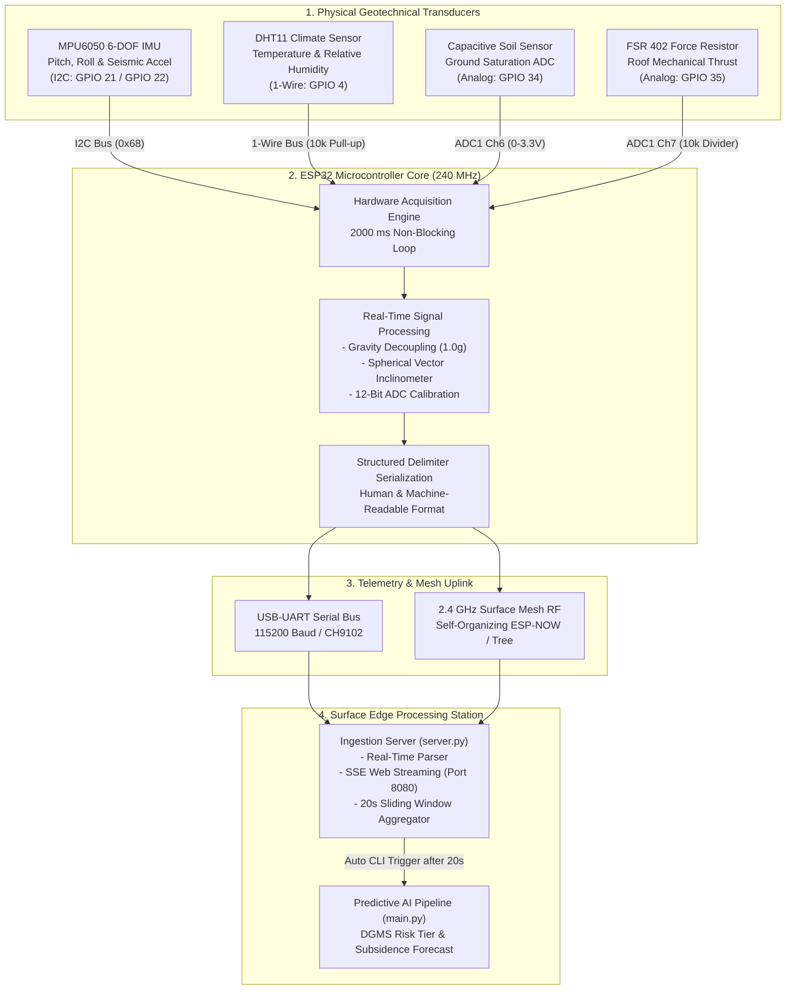
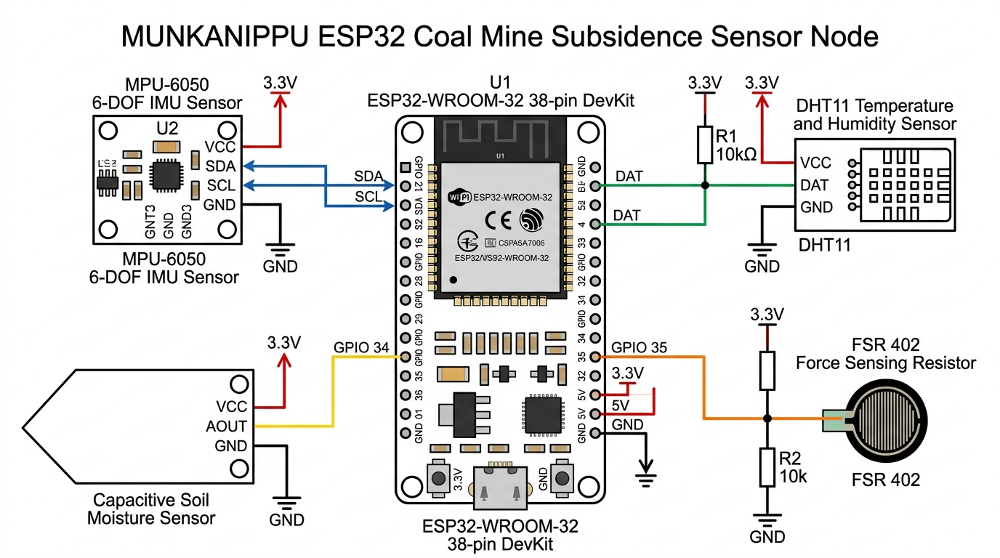
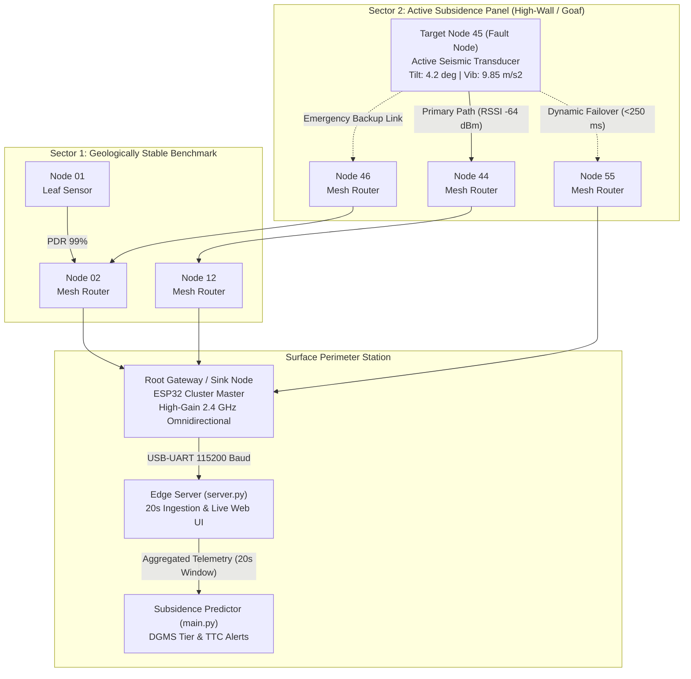

# MUNKANIPPU Hardware Node Specification & Architecture

This document provides the complete hardware engineering specification, physical circuit schematic, firmware logic, signal conversion mathematics, wireless surface mesh network architecture, and operational workflows for the **MUNKANIPPU Real-Time Geotechnical & Mine Subsidence Sensor Node**.

---

## 1. Hardware Architecture & End-to-End Data Flow

The sensor node is powered by an **ESP32-WROOM-32** microcontroller (38-pin DevKit). It continuously samples four physical parameters critical for detecting geotechnical strata movement, slope instability, and ground subsidence in coalfields:

1. **MPU6050 6-DOF IMU (I2C Bus: GPIO 21 / GPIO 22)**:
   * **Inclinometer Pitch & Roll**: Evaluates micro-angular rotation ($\theta_X, \theta_Y$) in degrees and normalized tilt percentage ($0^\circ \to 0\%$, $45^\circ \to 100\%$).
   * **Seismic / Dynamic Vibration**: Isolates dynamic acceleration components by decoupling Earth gravity ($1.0g$), scaled to $\text{m/s}^2$ ($0–10\text{ m/s}^2 = 0–100\%$).
2. **DHT11 Digital Climate Sensor (1-Wire: GPIO 4)**:
   * **Ambient Temperature & Relative Humidity**: Tracks environmental conditions inside the coal mine or on the surface bench ($0–50^\circ\text{C}$ and $20–90\%\text{ RH}$).
3. **Capacitive Ground Moisture Sensor (12-Bit ADC: GPIO 34)**:
   * **Ground Water Saturation**: Measures dielectric permittivity of mine soil/tailings ($0–100\%$, where $4095 \text{ ADC counts} = \text{Dry}$, and $1500 \text{ ADC counts} = \text{Saturated}$).
4. **FSR 402 Force-Sensing Resistor (12-Bit ADC: GPIO 35)**:
   * **Strata Thrust / Roof Convergence**: Translates mechanical compressive load into a voltage divider signal ($0–100\%$ force level).

### 1.1 Hardware Acquisition & Edge Processing Flow



---

## 2. Complete Circuit Diagram & Electrical Schematic

Below is the verified, high-resolution component-level circuit schematic for the MUNKANIPPU ESP32 Sensor Node:



### 2.1 Pinout & Electrical Interconnection Table

| Sensor Module | Module Pin | ESP32 Pin | Signal Type | Operating Voltage | Passive / Conditioning Network |
|---|---|---|---|---|---|
| **MPU6050** | **VCC** | **3V3** | DC Power | +3.3V | Decoupling 100nF ceramic capacitor to GND |
| **MPU6050** | **GND** | **GND** | Ground | 0V | Common system ground bus |
| **MPU6050** | **SDA** | **GPIO 21** | I2C Data | 3.3V Logic | 4.7kΩ pull-up to 3.3V (on module) |
| **MPU6050** | **SCL** | **GPIO 22** | I2C Clock | 3.3V Logic | 4.7kΩ pull-up to 3.3V (on module) |
| **MPU6050** | **AD0** | **GND** | Address Select | 0V | Pulls address pin LOW to select I2C address `0x68` |
| **DHT11** | **Pin 1 (VCC)** | **3V3** | DC Power | +3.3V | Common +3.3V power rail |
| **DHT11** | **Pin 2 (DATA)**| **GPIO 4** | 1-Wire Digital | 3.3V Logic | **10kΩ pull-up resistor** between VCC and DATA |
| **DHT11** | **Pin 4 (GND)** | **GND** | Ground | 0V | Common ground bus |
| **Soil Moisture** | **VCC** | **3V3** | DC Power | +3.3V | Common +3.3V power rail |
| **Soil Moisture** | **GND** | **GND** | Ground | 0V | Common ground bus |
| **Soil Moisture** | **AOUT** | **GPIO 34** | Analog Voltage | 0 to 3.3V | Direct connection to ESP32 ADC1 Channel 6 |
| **FSR 402** | **Terminal 1** | **3V3** | DC Power | +3.3V | Connected to +3.3V rail |
| **FSR 402** | **Terminal 2** | **GPIO 35** | Analog Divider | 0 to 3.3V | Connected to GPIO 35 (ADC1 Channel 7) |
| **FSR 402 Divider**| **Divider Resistor** | **GND** | Passive Divider | 0V | **10kΩ precision resistor** between GPIO 35 and GND |

> [!IMPORTANT]
> **GPIO 34** and **GPIO 35** on the ESP32 belong to ADC1 and are **input-only** pins with no internal pull-up or pull-down silicon resistors. External resistive networks (the 10kΩ divider for the FSR and the 10kΩ pull-up for the DHT11) must be connected as shown in the schematic.

---

## 3. Wireless Surface Mesh Network Architecture

In open-cast coalfields, longwall panels, and deep underground coal mines, point-to-point wireless signals (such as cellular or standard Wi-Fi) suffer from severe multipath fading, rock absorption, high-wall shadowing, and strata fracturing. A single-hop star topology fails as soon as a bench collapse or heavy excavator breaks direct line-of-sight.

The **MUNKANIPPU** system employs a **self-organizing, self-healing wireless surface mesh network** across an $N \times N$ node grid (e.g., 100 mesh nodes deployed across a $10 \times 10$ array over subsidence-prone strata).

### 3.1 Mesh Network Topology & Self-Healing Routing



### 3.2 Key Principles of the Mesh Network

#### 1. Node Roles & Functional Hierarchy
* **Edge Sensing Leaf Nodes (e.g., Node 01, Node 90, Node 99)**:
  Positioned on perimeter strata or stable monitoring benchmarks. They sample their local transducers (MPU6050, DHT11, Soil, FSR) and broadcast packets to parent routing nodes without maintaining routing tables for other nodes, conserving battery power.
* **Intermediate Mesh Routers (e.g., Node 02, Node 12, Node 44, Node 55)**:
  Equipped with persistent listening windows. They sample their own sensor payloads and actively forward encrypted multi-hop packets received from child nodes toward the root gateway using a tree-routing protocol.
* **Root Gateway / Sink Node (Cluster Master)**:
  Located at a structurally stable benchmark station at the surface perimeter. It serves as the bridge between the RF mesh network and the computing infrastructure (Surface Edge PC / Server running `server.py`).

#### 2. Self-Healing & Dynamic Link Rerouting
In active mining subsidence, ground movement can shear mounting bolts, tilt directional antennas, or bury nodes under rock falls.
* **Heartbeat & RSSI Monitoring**: Every node maintains a dynamic neighbor table ranked by **Received Signal Strength Indicator (RSSI)** and **Packet Delivery Ratio (PDR)**.
* **Automatic Route Failover**: If Target **Node 45** experiences link degradation with its primary parent (**Node 44**), it automatically switches routing within $<250\text{ ms}$ to alternate candidate parents (**Node 55** or **Node 46**), ensuring zero telemetry loss during active ground subsidence events.

#### 3. Time Synchronization & Collision Avoidance
* Nodes synchronize their internal real-time clocks using lightweight time-sync beacons broadcast periodically by the Root Gateway.
* Sensor transmission slots utilize **Carrier-Sense Multiple Access with Collision Avoidance (CSMA/CA)** combined with scheduled time-slotted transmissions (TDMA-like epoch allocations). This prevents RF packet collisions even when multiple nodes in an active fault zone trigger high-vibration alerts simultaneously.

---

## 4. Signal Conversion Formulas & Mathematical Logic

### 4.1 Inclinometer Pitch & Roll Estimation (MPU6050)
The MPU6050 accelerometer registers 16-bit 2's complement raw integer acceleration components along three Cartesian axes: $a_x, a_y, a_z$.

The inclination pitch angle $\theta_X$ (Angle X) and roll angle $\theta_Y$ (Angle Y) in degrees are computed through spherical vector projections using the two-argument arctangent:

$$\theta_X = \text{atan2}\left(a_y, \sqrt{a_x^2 + a_z^2}\right) \times \frac{180}{\pi}$$

$$\theta_Y = \text{atan2}\left(a_x, \sqrt{a_y^2 + a_z^2}\right) \times \frac{180}{\pi}$$

#### Tilt Normalization (0° to 45° Scale)
In mining strata and slope stability monitoring, an absolute tilt angle of $45^\circ$ represents an imminent landslide or tunnel wall deformation threshold. The tilt percentages are mapped linearly and constrained within $[0\%, 100\%]$:

$$\text{percentageX} = \text{clamp}\left(\frac{|\theta_X|}{45.0} \times 100.0,\; 0,\; 100\right)$$

$$\text{percentageY} = \text{clamp}\left(\frac{|\theta_Y|}{45.0} \times 100.0,\; 0,\; 100\right)$$

---

### 4.2 Dynamic Seismic Vibration & Gravity Decoupling
The MPU6050 default full-scale range is $\pm 2g$, providing a sensitivity of $16384 \text{ LSB}/g$.

1. **Convert raw integer acceleration to physical units of $g$**:
   $$a_{x,g} = \frac{a_x}{16384.0}, \quad a_{y,g} = \frac{a_y}{16384.0}, \quad a_{z,g} = \frac{a_z}{16384.0}$$

2. **Compute total acceleration magnitude vector**:
   $$\|a_{\text{total}}\| = \sqrt{a_{x,g}^2 + a_{y,g}^2 + a_{z,g}^2}$$

3. **Decouple static Earth gravity ($1.0g$) to isolate dynamic vibration**:
   $$a_{\text{vib},g} = \left|\|a_{\text{total}}\| - 1.0\right|$$

4. **Convert to SI acceleration ($\text{m/s}^2$)**:
   $$\text{vibration} = a_{\text{vib},g} \times 9.81$$

5. **Normalize to 0–100% scale (where $10.0 \text{ m/s}^2 = 100\%$)**:
   $$\text{vibrationLevel} = \text{clamp}\left(\frac{\text{vibration}}{10.0} \times 100.0,\; 0,\; 100\right)$$

---

### 4.3 Soil Moisture Capacitive/Resistive ADC Transformation
The ESP32 uses a 12-bit successive approximation ADC (`0` to `4095` counts across $0\text{V}$ to $3.3\text{V}$).

* In air / completely dry soil, the sensor probe outputs maximum resistance or minimum capacitance, resulting in a high analog read of $\approx 4095$.
* In saturated water, the probe outputs maximum conduction / capacitance, pulling the reading down to $\approx 1500$.

The moisture percentage is inversely mapped:
$$\text{moisture} = \text{clamp}\left(\left\lfloor \frac{4095 - \text{soilRaw}}{4095 - 1500} \times 100 \right\rfloor,\; 0,\; 100\right)$$

---

### 4.4 Force-Sensitive Resistor (FSR) Roof Pressure Transformation
The FSR 402 is configured in a voltage divider circuit with a $10\text{ k}\Omega$ pull-down resistor:
$$V_{\text{out}} = V_{\text{CC}} \times \frac{R_{\text{divider}}}{R_{\text{FSR}} + R_{\text{divider}}}$$

* With no mechanical pressure applied, $R_{\text{FSR}} > 1\text{ M}\Omega$, driving $V_{\text{out}} \approx 0\text{V}$ ($\text{ADC} \approx 0$).
* Under heavy mechanical compression (mine roof convergence or subsidence thrust), $R_{\text{FSR}} \to 200\,\Omega$, pulling $V_{\text{out}} \to 3.3\text{V}$ ($\text{ADC} \to 4095$).

The force percentage is mapped:
$$\text{forceLevel} = \text{clamp}\left(\left\lfloor \frac{\text{fsrRaw}}{4095} \times 100 \right\rfloor,\; 0,\; 100\right)$$

---

## 5. Structured Serial Protocol Specification

Every 2 seconds, the firmware outputs a structured delimiter packet over `Serial` at 115200 baud. This format is designed for parsing by automated ingestion engines (`server.py`, Python regex parsers, and node orchestrators):

```text
======================================
            SENSOR DATA
======================================

========== MPU6050 ==========
Angle X      : -17.38 deg
Angle X      : 38.6 %
Angle Y      : -69.25 deg
Angle Y      : 100.0 %

Vibration    : 0.07 m/s^2
Vibration Level: 0.7 %
==============================

---------- DHT11 ----------
Temperature    : 31.10 °C
Humidity       : 69.50 %

------ SOIL MOISTURE ------
Raw Value      : 4095
Moisture       : 0 %

----------- FSR -----------
Raw Value      : 117
Force Level    : 2 %

======================================
```

---

## 6. Downstream 20-Second Window ML Integration

Telemetry transmitted through the mesh terminates at the Root Gateway and is fed into `server.py`. The ingestion engine aggregates the telemetry stream across 20-second sliding windows, outputting the standardized CLI command:

```bash
python main.py --node-id 45 --disp 42.5 --tilt 4.2 --vib 9.85 --temp 31.0 --vel 1.8
```

This triggers the AI predictive model (`main.py`) to infer the next 6-hour and 24-hour subsidence delta, evaluate Directorate General of Mines Safety (DGMS) risk tiers, and compute Time-To-Critical (TTC) alert margins.

---

## 7. Calibration & Operational Guidelines

1. **Inclinometer Zeroing (MPU6050 Level Plane)**:
   * Place the ESP32 enclosure on a flat, calibrated surface before installation.
   * If mounting on an inclined rock bolt or tunnel rib, record the resting pitch/roll offset and calibrate within the base software configuration.

2. **Soil Moisture Threshold Tuning**:
   * Dry sandstone/coal dust: ADC readings typically range between `3800` and `4095`.
   * Water-saturated mud/clay: ADC readings drop below `1800`.
   * Adjust the `map(soilRaw, 4095, 1500, 0, 100)` constants in firmware to suit specific coal basin soil conductivity.

3. **FSR Resistor Divider Calibration**:
   * The default pull-down resistor is $10\text{ k}\Omega$. For low-pressure detection (sensitive strata displacement), increase the pull-down resistor to $47\text{ k}\Omega$. For high-force roof collapse monitoring, decrease the pull-down resistor to $3.3\text{ k}\Omega$.

4. **Cable Routing & Noise Immunity**:
   * Use shielded twisted-pair (STP) cabling for I2C lines (SDA/SCL) extending beyond 30 cm.
   * Add a $100\text{ nF}$ ceramic decoupling capacitor near the MPU6050 VCC/GND pins to filter high-frequency switching noise from the ESP32 internal radio/power rails.
