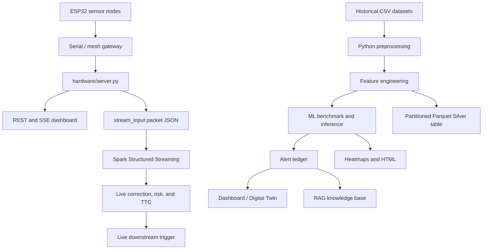

# MUNKANIPPU: AI-Enabled Coal-Mine Subsidence Monitoring

## Project Analysis and Presentation Content

This document provides a complete 21-section presentation narrative for the
MUNKANIPPU project. It describes the implemented ESP32 sensing layer, hardware
ingestion service, Python machine-learning pipeline, Apache Spark batch and
streaming pipelines, visual outputs, Digital Twin, and RAG assistant.

> **Scope note:** This is a decision-support and research prototype. DGMS risk
> tiers and time-to-critical values must be reviewed by qualified mine-safety
> personnel before operational use.

---

## 1. Title Slide

### MUNKANIPPU

**AI-Enabled Wireless Surface Mesh Network for Real-Time Coal-Mine Subsidence
Detection**

- **Domain:** Mining safety, geotechnical monitoring, IoT, machine learning
- **Core objective:** Detect, classify, visualize, and communicate subsidence
  risk before it becomes a critical safety event
- **Primary technologies:** ESP32, MPU6050, DHT11, soil and force sensors,
  Python, Pandas, scikit-learn, Apache Spark, Parquet, Three.js, and RAG
- **Project outputs:** Sensor telemetry, engineered features, predictions,
  risk alerts, heatmaps, streaming events, and an interactive assistant

Project source areas:

- [`spark/`](spark/)
- [`hardware/`](hardware/)
- [`output/`](output/)
- [`../../tunnel-digital-twin/`](../../tunnel-digital-twin/)
- [`../../munkanippu_rag/`](../../munkanippu_rag/)

---

## 2. Abstract

Coal-mine subsidence can damage infrastructure, affect mine stability, and
endanger workers. MUNKANIPPU addresses this problem with a layered monitoring
platform that combines low-cost wireless sensor nodes, real-time ingestion,
spatio-temporal feature engineering, machine-learning prediction, and
visual risk communication.

An ESP32 sensor node collects inclination, vibration, temperature, humidity,
soil moisture, and force-related measurements. The hardware bridge parses the
serial protocol, exposes REST and Server-Sent Events (SSE) endpoints, and
creates telemetry packets for downstream processing. The Python pipeline
converts strain and accelerometer signals into displacement, tilt, vibration,
thermal-corrected values, temporal deltas, and spatial gradients.

The project benchmarks Isolation Forest, XGBoost, a temporal MLP, and Random
Forest models. It predicts one-hour and six-hour displacement deltas instead of
directly extrapolating an unbounded absolute value. Predictions are
reconstructed into six-hour and 24-hour subsidence estimates and classified
into Safe, Advisory, Warning, and Critical tiers. Apache Spark provides a
scalable batch feature pipeline and a Structured Streaming pipeline for
incremental JSON telemetry.

The generated project artifacts include 50,000 engineered feature rows, a
100-node alert ledger, risk heatmaps, a benchmark chart, partitionable Parquet
features, and an interactive HTML visualization.

---

## 3. Problem Statement

### Existing mining-monitoring problems

1. Manual inspections are periodic and may miss rapidly changing conditions.
2. Sensor readings are heterogeneous and arrive at different rates.
3. Temperature, vibration, packet loss, and sensor noise can distort raw
   displacement estimates.
4. Wireless packets can arrive late or out of order.
5. A single absolute-displacement model can accumulate extrapolation error.
6. Raw telemetry is difficult for safety teams to interpret without spatial
   maps and severity categories.
7. Historical CSV analysis alone does not provide a real-time alert path.

### Problem definition

Given sensor measurements from a distributed mine panel, estimate current and
future ground deformation, identify the affected mesh nodes, calculate the
time margin before a critical threshold, and communicate the result through
machine-readable alerts and human-readable visualizations.

---

## 4. Objectives

### Primary objectives

- Build a low-cost ESP32-based multi-sensor monitoring node.
- Parse and normalize sensor telemetry at an edge server.
- Map sensor data to a spatial mesh of up to 100 nodes.
- Remove thermal drift and reduce high-frequency sensor noise.
- Engineer temporal, spatial, structural, and network-health features.
- Predict incremental subsidence over one-hour and six-hour horizons.
- Reconstruct 24-hour subsidence from six-hour predicted deltas.
- Classify nodes using four DGMS-inspired risk tiers.
- Estimate Time-To-Critical (TTC) for early warning.
- Provide both historical batch processing and live streaming processing.
- Generate heatmaps, alert ledgers, interactive HTML views, and dashboards.
- Preserve a path for scalable Spark deployment and future model upgrades.

### Success criteria

- Sensor packets can be parsed without stopping the ingestion service.
- Historical data produces deterministic engineered features.
- Risk outputs contain node identity, location, prediction, tier, and TTC.
- Streaming input can be processed incrementally with watermarking and
  checkpoint recovery.
- Outputs are understandable to both technical users and safety operators.

---

## 5. Existing System

The baseline or conventional approach typically consists of:

- Standalone sensors or periodic manual readings.
- Local CSV files with limited standardization.
- Separate scripts for preprocessing, analysis, and visualization.
- Threshold checks without temporal context.
- No unified relationship between sensor location and predicted risk.
- Batch-only analysis with delayed reporting.

### Limitations of the existing approach

- It is reactive rather than predictive.
- It does not consistently compensate for environmental effects.
- It does not model node-specific time history.
- It cannot efficiently process continuous telemetry at scale.
- It offers limited traceability from a warning back to the source packet.
- It may produce a large amount of raw data without prioritizing alerts.

MUNKANIPPU retains simple thresholds as an interpretable safety layer but adds
feature engineering, model benchmarking, streaming, spatial visualization, and
an auditable alert ledger.

---

## 6. Proposed System

The proposed platform is an end-to-end pipeline:

```text
ESP32 sensors
    ↓
Serial / wireless telemetry
    ↓
hardware/server.py
    ├── REST status and control endpoints
    ├── Server-Sent Events for live UI updates
    └── JSON packets for Spark streaming
    ↓
Historical CSV / live JSON ingestion
    ↓
Preprocessing and feature engineering
    ├── Noise smoothing and imputation
    ├── Thermal correction
    ├── Temporal lags and rolling statistics
    └── Spatial mesh and strain gradients
    ↓
ML models + DGMS rule layer
    ↓
Delta predictions, risk tier, TTC
    ├── alert_ledger.csv
    ├── heatmaps and interactive HTML
    ├── Spark Parquet Silver output
    ├── dashboard / Digital Twin
    └── RAG knowledge assistant
```

### Design characteristics

- **Hybrid:** combines physical formulas, interpretable rules, and ML.
- **Spatio-temporal:** uses both node history and panel location.
- **Dual-mode:** supports historical batch and near-real-time streaming.
- **Fault-tolerant:** uses Spark checkpoints and bounded late-event handling.
- **Extensible:** model wrappers and pipeline stages can be replaced
  independently.

---

## 7. Technologies Used

| Layer | Technologies |
|---|---|
| Embedded sensing | ESP32-WROOM-32, Arduino C++, MPU6050, DHT11, soil sensor, FSR 402 |
| Connectivity | I2C, ADC, USB-UART, serial telemetry, planned mesh transport |
| Edge service | Python, `http.server`, threading, PySerial, REST, SSE |
| Data processing | Python, Pandas, NumPy, SciPy, PyArrow |
| Machine learning | scikit-learn, XGBoost, StandardScaler, Random Forest, MLP, Isolation Forest |
| Distributed processing | Apache Spark, PySpark, Spark SQL windows, Structured Streaming |
| Storage | CSV, JSON, Parquet, checkpoint directories |
| Visualization | Matplotlib, SciPy RBF interpolation, Plotly HTML |
| Frontend | Vite, TypeScript/JavaScript, Three.js, HTML/CSS |
| Knowledge assistant | Streamlit, retrieval-augmented generation components |
| Testing and operation | Python smoke tests, deterministic simulation mode, CLI options |

Important implementation files include [`spark/main.py`](spark/main.py),
[`spark/feature_engineering.py`](spark/feature_engineering.py),
[`spark/benchmark.py`](spark/benchmark.py),
[`spark/spark_feature_pipeline.py`](spark/spark_feature_pipeline.py),
[`spark/spark_streaming_pipeline.py`](spark/spark_streaming_pipeline.py), and
[`hardware/server.py`](hardware/server.py).

---

## 8. System Architecture



### Architecture layers

1. **Sensing layer:** physical transducers measure deformation-related signals.
2. **Transport layer:** serial output and mesh-ready telemetry move data to the
   edge station.
3. **Ingestion layer:** parsing, state management, REST, SSE, and packet
   persistence.
4. **Analytics layer:** cleaning, feature engineering, Spark transformations,
   and model inference.
5. **Decision layer:** risk tiers, TTC, alert ledger, and downstream commands.
6. **Presentation layer:** web dashboard, heatmaps, Digital Twin, and RAG.

---

## 9. Methodology / Workflow

### Offline workflow

1. Load building-health, BIM/civil, temperature, and WSN datasets.
2. Parse timestamps and convert numeric fields.
3. Sort sensor records by time and node.
4. Impute missing numeric values using forward fill and median fallback.
5. Smooth strain, acceleration, and temperature using a causal rolling window.
6. Convert strain to displacement and acceleration to tilt/vibration.
7. Apply thermal drift compensation.
8. Build a regular spatial mesh and assign WSN nodes using nearest-neighbor
   matching.
9. Combine sensor, structural, network, temporal, and spatial features.
10. Create one-hour and six-hour delta targets.
11. Split data chronologically into 80% training and 20% testing.
12. Scale model features using `StandardScaler`.
13. Train and benchmark the candidate models.
14. Reconstruct future displacement and assign risk tiers.
15. Write alerts, charts, and processed features.

### Online workflow

1. ESP32 emits a structured telemetry packet every approximately two seconds.
2. `server.py` parses the packet and broadcasts state through SSE.
3. The server writes JSON files into `stream_input/`.
4. Spark reads new files in micro-batches.
5. Spark applies a ten-second event-time watermark.
6. Tilt, displacement proxy, velocity, risk tier, and TTC are calculated.
7. A 20-second trigger calls `process_micro_batch`.
8. The callback prints status and creates a standardized ML command.
9. Production deployments can replace the callback with an asynchronous alert
   publisher or controlled inference service.

---

## 10. Dataset Description

The project currently contains four principal CSV datasets:

| Dataset | Observed size | Main purpose |
|---|---:|---|
| `building_health_monitoring_dataset.csv` | 1,000 data rows | Timestamped accelerometer, strain, temperature, and condition data |
| `WSN_Dataset.csv` | 10,000 data rows | Node coordinates, energy, signal, packet loss, and network metrics |
| `bim_ai_civil_engineering_dataset.csv` | 1,000 data rows | Project, structural, vibration, crack, load, and safety context |
| `TEMP_ANNUAL_SEASONAL_MEAN.csv` | 123 data rows | Annual and seasonal temperature baselines |

The main preprocessing stage samples and expands the combined signals into a
10 × 10 mesh simulation. The generated
[`output/processed_features.csv`](output/processed_features.csv) contains
50,000 data rows and 31 columns, including:

- Sensor and location data: `MeshNode_ID`, `Grid_X`, `Grid_Y`
- Physical values: displacement, tilt, vibration, temperature
- Network health: signal strength, packet loss, residual energy
- Structural context: vibration, crack width, load-bearing capacity, safety
- Temporal features: lags, deltas, rolling means, and rolling standard deviation
- Targets: `Delta_Disp_1h`, `Delta_Disp_6h`
- Label: `Risk_Tier`

### Data quality considerations

- Timestamps are parsed and ordered before time-dependent calculations.
- Missing numeric values are forward-filled, then median-imputed.
- The building-health source contains encoded unit characters in its CSV header
  in some environments; loaders use the repository’s current column names.
- Synthetic or simulated physical evolution is used where the source datasets
  do not provide a complete multi-node subsidence history.

---

## 11. Modules Description

### 11.1 Hardware and ingestion

- [`hardware/esp32_sensors.ino`](hardware/esp32_sensors.ino): reads MPU6050,
  DHT11, soil, and FSR values; converts them to engineering units; emits
  structured serial text.
- [`hardware/server.py`](hardware/server.py): manages serial connections,
  auto-detects USB ports, parses sensor sections, maintains latest state,
  broadcasts SSE messages, and serves the dashboard API.
- [`hardware/mongo_manager.py`](hardware/mongo_manager.py): optional persistence
  integration for telemetry or alert storage.

### 11.2 Preprocessing and modeling

- [`spark/preprocess.py`](spark/preprocess.py): compatibility exports for the
  feature-engineering functions.
- [`spark/feature_engineering.py`](spark/feature_engineering.py): loading,
  imputation, smoothing, mesh mapping, physical calculations, and feature
  creation.
- [`spark/benchmark.py`](spark/benchmark.py): chronological split, model
  wrappers, metrics, and alert generation.
- [`spark/main.py`](spark/main.py): command-line orchestrator and custom sensor
  input analyzer.
- [`spark/kalman_filter.py`](spark/kalman_filter.py): optional recursive
  filtering for noisy telemetry.

### 11.3 Distributed processing

- [`spark/spark_feature_pipeline.py`](spark/spark_feature_pipeline.py):
  historical batch transformation and partitioned Parquet output.
- [`spark/spark_streaming_pipeline.py`](spark/spark_streaming_pipeline.py):
  live JSON file ingestion, watermarking, risk calculations, and micro-batch
  callbacks.

### 11.4 Visualization and applications

- [`spark/visualize_heatmap.py`](spark/visualize_heatmap.py): RBF interpolation,
  current/predicted/risk heatmaps, and benchmark visualization.
- [`../../tunnel-digital-twin/`](../../tunnel-digital-twin/): Three.js/Vite
  visualization layer for the monitored environment.
- [`../../munkanippu_rag/`](../../munkanippu_rag/): retrieval assistant over
  project documentation and generated knowledge artifacts.

---

## 12. Spark and Scala Concepts Used

The implementation is written in PySpark, but the concepts are directly
applicable to Scala Spark applications.

### Spark concepts

- `SparkSession` as the entry point for batch and streaming jobs.
- DataFrames and typed schemas for structured telemetry.
- Spark SQL expressions for column transformations.
- `Window.partitionBy(node).orderBy(timestamp)` for per-node history.
- `lag` for one-hour, two-hour, three-hour, and six-hour context.
- `withWatermark` for bounded late-event handling.
- `readStream` and `writeStream` for incremental processing.
- `foreachBatch` for micro-batch integration.
- `checkpointLocation` for streaming restart recovery.
- `partitionBy("DGMS_Risk_Tier")` for risk-oriented Parquet layout.
- Local execution modes `local[*]` and `local[2]` for development.

### Scala concepts transferable to this design

- Immutable transformation chains.
- Case-class-like schema discipline for telemetry records.
- Typed `Dataset` design for production-grade interfaces.
- Functional transformations such as `map`, `filter`, and `withColumn`.
- Encapsulation of streaming logic in reusable services.
- Cluster deployment through `spark-submit` rather than hard-coding local
  execution.

### Batch versus streaming

| Concern | Batch | Streaming |
|---|---|---|
| Source | Historical CSV | New JSON files |
| API | `spark.read` | `spark.readStream` |
| State | Per-node windows | Watermark and checkpoint |
| Cadence | One complete run | 20-second trigger |
| Output | Partitioned Parquet | Callback and live alerts |

If PySpark is unavailable, the batch script uses a Pandas/PyArrow fallback and
the streaming script runs a deterministic simulation demo. These modes validate
logic but are not substitutes for distributed execution.

---

## 13. Implementation Details

### 13.1 Sensor conversion

The ESP32 firmware:

- Samples the MPU6050 through I2C on GPIO 21/22.
- Reads DHT11 temperature and humidity on GPIO 4.
- Reads soil moisture through ADC GPIO 34.
- Reads FSR force through ADC GPIO 35.
- Uses 115200 baud serial output.
- Emits human-readable section delimiters that `server.py` recognizes.

### 13.2 Edge server

`server.py` maintains thread-safe sensor state with a lock, a serial reader
thread, a bounded raw-line buffer, and a list of SSE clients. It provides:

- Port listing and USB-port prioritization.
- Connect/disconnect operations.
- Current status and latest sensor data.
- Raw telemetry events.
- Live status events.
- Dashboard static-file serving.

### 13.3 Physical feature calculations

```text
Displacement_raw_mm = smoothed_strain_microstrain × 10^-6 × gauge_length_mm
Tilt_deg = degrees(atan2(|Accel_X|, |Accel_Z|))
Vibration_RMS = sqrt(Accel_X² + Accel_Y² + Accel_Z²)
Disp_corr = Disp_raw - alpha × (Temperature - baseline_temperature)
```

The Python physical feature pipeline uses `alpha = 0.012` by default, while
the Spark implementation uses a configurable default of `0.05` and a 24.6 °C
baseline. These parameters should be calibrated consistently for a production
deployment.

### 13.4 Spatial mapping

The system builds a regular 10 × 10 grid and uses a SciPy `cKDTree` to map
available WSN coordinates to the nearest mesh positions. The resulting mesh
contains 100 logical nodes with grid coordinates and latest network context.

### 13.5 Model input and split

The benchmark uses up to 25 feature columns covering physical, structural,
network, temporal, and spatial behavior. Data is sorted by timestamp and node,
then split chronologically: the first 80% is training data and the latest 20%
is held out for testing. This avoids random shuffling across time.

---

## 14. Algorithm / Processing Logic

### Step 1: Cleaning and smoothing

1. Parse timestamps.
2. Sort records.
3. Forward-fill numeric gaps.
4. Fill remaining numeric gaps with medians.
5. Apply a five-sample causal rolling mean to high-frequency signals.

### Step 2: Displacement and tilt

Convert strain to displacement, accelerometer values to tilt, and three-axis
acceleration to vibration magnitude.

### Step 3: Thermal correction

```text
Disp_corr = Disp_raw - α × (T_current - T_baseline)
```

This reduces apparent displacement caused by temperature changes.

### Step 4: Temporal features

For each mesh node ordered by time:

```text
Delta_Disp_1h = Disp(t) - Disp(t-1)
Delta_Disp_6h = Disp(t) - Disp(t-6)
```

The pipeline also creates displacement lags, velocity, tilt velocity, rolling
delta, rolling velocity, and rolling vibration statistics.

### Step 5: Model inference and reconstruction

The ML model predicts incremental displacement:

```text
Predicted_Subsidence_6h = Current_Displacement + Predicted_Delta_6h
Predicted_Subsidence_24h = Current_Displacement + 4 × Predicted_Delta_6h
```

Predicting deltas limits the unbounded-extrapolation problem of directly
predicting absolute future subsidence.

### Step 6: Risk classification

The project uses the following interpretable decision-support bands:

| Absolute projected displacement | Tier |
|---:|---|
| `< 10 mm` | Safe |
| `10 to < 25 mm` | Advisory |
| `25 to < 50 mm` | Warning |
| `>= 50 mm` | Critical |

### Step 7: TTC

```text
TTC_hours = (50 - |Disp_corr|) / positive_velocity
```

When velocity is not above the configured minimum, the pipeline uses `999.0`
as a stable/no-action sentinel. In custom CLI analysis, an already breached
threshold is reported as `0.0 hours (BREACHED)`.

### Streaming-specific formulas

For a live packet without direct displacement:

```text
tilt_angle = sqrt(angle_x² + angle_y²)
disp_corr = (force_level_pct × 0.5) - (temperature - 24.6) × 0.05
velocity = vibration × 0.18
```

---

## 15. Output Screenshots

The following artifacts are generated by the current project and can be used
as presentation screenshots:

1. **Three-panel subsidence heatmap:**  
   [`output/subsidence_heatmap.png`](output/subsidence_heatmap.png)  
   Shows current deformation, predicted 24-hour deformation, and risk zones.

2. **Model benchmark chart:**  
   [`output/benchmark_chart.png`](output/benchmark_chart.png)  
   Compares candidate models using regression and classification metrics.

3. **Interactive Plotly heatmap:**  
   [`output/subsidence_interactive.html`](output/subsidence_interactive.html)  
   Supports browser-based exploration of node values and risk.

4. **Alert ledger:**  
   [`output/alert_ledger.csv`](output/alert_ledger.csv)  
   Contains 100 node-level alert records with coordinates, forecasts, tier, and
   TTC.

5. **ESP32 circuit diagram:**  
   [`hardware/circuit_diagram.jpg`](hardware/circuit_diagram.jpg)

6. **Hardware dashboard:**  
   [`hardware/index.html`](hardware/index.html)

7. **Digital Twin frontend:**  
   [`../../tunnel-digital-twin/`](../../tunnel-digital-twin/)

### Suggested slide captions

- “Current and forecasted subsidence across the monitored panel”
- “Risk-tier spatialization for prioritizing inspection”
- “Benchmark comparison of delta-prediction models”
- “Live edge telemetry and sensor connection status”
- “Digital Twin view of the monitored tunnel/panel”

---

## 16. Results and Discussion

### Current generated artifacts

The checked-in output files provide the following observed results:

- `processed_features.csv`: **50,000 data rows**
- `alert_ledger.csv`: **100 data rows**, one per mesh node
- Current alert risk distribution:
  - **Safe:** 20 nodes
  - **Advisory:** 63 nodes
  - **Warning:** 17 nodes
  - **Critical:** 0 nodes
- Current displacement range in the alert ledger: approximately **5.86–35.74
  mm**
- Predicted 24-hour displacement range: approximately **6.17–37.83 mm**
- Predicted 24-hour displacement average: approximately **17.46 mm**
- TTC values range from approximately **163.75 to 3,709.96 hours** in the
  generated ledger.

### Interpretation

The generated ledger identifies a predominantly Safe/Advisory panel with a
smaller Warning region and no currently Critical node under the stored
prediction. This is consistent with the maximum predicted value remaining
below the 50 mm Critical threshold. The Warning nodes are candidates for
closer inspection and higher-frequency sampling.

The feature table contains 32,184 Safe, 16,613 Advisory, and 1,203 Warning
rows, with no Critical rows in the observed file. The difference between row
counts and the 100-node alert ledger is expected because the feature table
contains many time steps per node, while the alert ledger represents the
latest node-level state.

### Model discussion

The benchmark design is stronger than a single-model claim because it compares:

- An anomaly baseline (Isolation Forest).
- A gradient-boosting model (XGBoost).
- A nonlinear temporal feature model (MLP).
- A bagging ensemble (Random Forest).

Exact metric values should be read from the generated benchmark chart or
regenerated with the current environment. Results should not be compared across
runs without recording dataset versions, dependency versions, feature
parameters, and random seeds.

---

## 17. Testing and Validation

### Implemented validation paths

1. **Hardware endpoint smoke testing:** use
   `python hardware\test_server_endpoints.py`.
2. **Streaming simulation:** run
   `python spark\spark_streaming_pipeline.py` when PySpark is unavailable.
3. **Batch fallback:** use the Pandas/PyArrow path when PySpark is unavailable.
4. **Chronological holdout:** reserve the latest 20% for evaluation.
5. **Regression metrics:** MAE, RMSE, and R².
6. **Classification metrics:** macro F1, PR-AUC, and false-alarm rate.
7. **Output inspection:** verify row counts, risk labels, generated files, and
   alert columns.
8. **Operational checks:** verify input paths, timestamp parsing, writable
   output paths, and checkpoint paths before running Spark.

### Validation checklist

- [ ] Confirm the ESP32 serial port and baud rate.
- [ ] Confirm all sensors initialize successfully.
- [ ] Confirm `server.py` reports a connected port.
- [ ] Confirm raw and parsed SSE events are visible.
- [ ] Confirm packets are written to `stream_input/`.
- [ ] Confirm Spark schema matches packet fields.
- [ ] Confirm no unexpected null node IDs or timestamps.
- [ ] Confirm one record per expected node/time step.
- [ ] Confirm risk tiers match threshold rules.
- [ ] Confirm TTC is finite for positive velocity and sentinel-valued for
  stable readings.
- [ ] Confirm generated Parquet partitions and alert files exist.
- [ ] Confirm restart recovery with the configured checkpoint.

### Important validation observation

The repository contains two related threshold/configuration implementations:
the Python feature-engineering module defines a `warning_displacement_mm` value
of 40 mm, while the Spark and documented operational tier logic use 25 mm as
the Warning boundary. A production release should centralize these thresholds
and add a cross-pipeline consistency test.

---

## 18. Challenges Faced and Solutions

| Challenge | Solution |
|---|---|
| Sensor noise and missing values | Rolling smoothing, forward fill, median imputation |
| Temperature-induced measurement drift | Thermal correction using calibrated baseline and coefficient |
| Different sensor types and units | Explicit physical conversion functions and schemas |
| Per-node temporal dependency | Window functions and grouped lag features |
| Out-of-order wireless packets | Spark event-time watermarking |
| Streaming restart recovery | Checkpoint directory |
| Limited local Spark availability | Pandas/PyArrow batch fallback and streaming simulation |
| Large spatial data interpretation | 10 × 10 mesh, RBF interpolation, and heatmaps |
| Absolute prediction extrapolation | Predict one-hour/six-hour deltas and reconstruct future values |
| Model selection uncertainty | Benchmark multiple model families with common metrics |
| Human-readable safety reporting | Four named tiers, TTC, alert ledger, and CLI summaries |
| Dashboard responsiveness | Background serial reader and SSE event delivery |
| Hardware/environment variability | Calibration guidance for tilt, soil, and FSR sensors |
| Configuration drift across pipelines | Recommended shared constants and consistency tests |

### Known prototype limitations

- The streaming callback collects micro-batches on the driver; large
  deployments should use a distributed or asynchronous sink.
- The live displacement is a force/temperature proxy, whereas the batch path
  generally starts from measured or derived displacement.
- Local Spark settings are suitable for demonstration, not cluster production.
- Physical thresholds require field calibration and regulatory review.
- A simulated mesh does not replace long-duration field observations.

---

## 19. Conclusion

MUNKANIPPU demonstrates a complete architecture for coal-mine subsidence
monitoring. It connects physical sensing to edge ingestion, feature
engineering, machine learning, distributed processing, risk classification,
visualization, and operator-facing applications.

The most important design decision is to predict incremental displacement and
then reconstruct future absolute subsidence. This combines model flexibility
with interpretable physical reasoning. Spark batch and streaming paths provide
a scalable route beyond local experimentation, while the alert ledger,
heatmaps, Digital Twin, and RAG assistant make the results accessible to
different users.

The present generated results show Safe, Advisory, and Warning states without a
Critical node in the stored alert snapshot. This should be interpreted as the
result of the current data and parameters, not as evidence that the monitored
mine is permanently safe.

---

## 20. Future Enhancements

### Sensing and networking

- Add LoRaWAN, ESP-NOW, or industrial wireless transport with encryption.
- Add GPS/time synchronization and packet sequence numbers.
- Add redundant sensors and automated sensor-health diagnostics.
- Store calibration metadata per physical node.
- Add edge buffering for network outages.

### Data and modeling

- Replace simulated deformation with long-duration field-labelled data.
- Calibrate thermal coefficients per material and location.
- Add uncertainty intervals and calibrated probabilities.
- Add drift detection and model retraining schedules.
- Evaluate temporal transformers, gradient boosting with explainability, and
  graph neural networks for neighboring nodes.
- Use cross-validation by time period and mine panel.

### Spark and deployment

- Package jobs for `spark-submit` and cluster schedulers.
- Replace driver-side `collect()` in streaming callbacks.
- Add schema registry and data-quality quarantine.
- Write streaming output to a durable Delta/Parquet or event-stream sink.
- Add observability for processing latency, dropped packets, and checkpoint age.

### Applications and safety

- Add role-based authentication and audit trails.
- Add SMS, email, or control-room notification integrations.
- Add Digital Twin playback and time-slider analysis.
- Add explainable alert cards showing the features behind each warning.
- Integrate mine plans, strata layers, boreholes, and geotechnical inspection
  records.
- Establish formal safety validation with domain experts and regulators.

---

## 21. References

### Project references

1. [`spark/README.md`](spark/README.md) — ML and Spark project overview.
2. [`spark/SPARK_ARCHITECTURE.md`](spark/SPARK_ARCHITECTURE.md) — end-to-end
   Spark architecture and formulas.
3. [`spark/SPARK_PIPELINES.md`](spark/SPARK_PIPELINES.md) — execution and
   operations guide.
4. [`spark/spark_readme.md`](spark/spark_readme.md) — batch and streaming
   implementation explanation.
5. [`spark/feature_engineering.py`](spark/feature_engineering.py) — physical
   and spatio-temporal feature construction.
6. [`spark/benchmark.py`](spark/benchmark.py) — model wrappers and metrics.
7. [`spark/spark_feature_pipeline.py`](spark/spark_feature_pipeline.py) —
   distributed batch processing.
8. [`spark/spark_streaming_pipeline.py`](spark/spark_streaming_pipeline.py) —
   Structured Streaming processing.
9. [`hardware/README.md`](hardware/README.md) — hardware architecture and
   calibration information.
10. [`hardware/esp32_sensors.ino`](hardware/esp32_sensors.ino) — ESP32
    acquisition firmware.
11. [`hardware/server.py`](hardware/server.py) — serial bridge and web server.
12. [`output/alert_ledger.csv`](output/alert_ledger.csv) — generated node-level
    results.
13. [`output/processed_features.csv`](output/processed_features.csv) —
    generated feature matrix.

### Technical references

14. Apache Spark documentation: DataFrames, SQL Window functions, Structured
    Streaming, watermarks, and checkpoints.
15. scikit-learn documentation: preprocessing, ensemble models, MLP models,
    anomaly detection, and evaluation metrics.
16. XGBoost documentation: gradient-boosted decision trees for regression and
    classification.
17. Espressif ESP32 documentation: GPIO, ADC, I2C, serial communication, and
    power considerations.
18. MPU6050, DHT11, capacitive soil-moisture, and FSR 402 component
    documentation.
19. Directorate General of Mines Safety (DGMS), India: mine-safety guidance
    and site-specific limits. Thresholds in this project are decision-support
    values and require formal validation before operational adoption.

